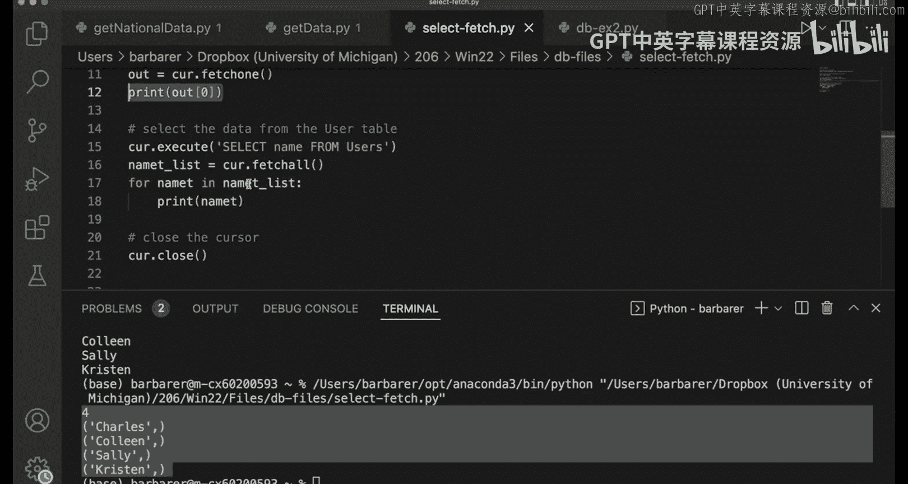

# 创造性编程：44：fetchone与fetchall应用 🐍


在本节课中，我们将学习如何使用Python数据库游标对象的 `fetchone()` 和 `fetchall()` 方法来处理SQL查询结果。我们将了解它们各自的适用场景以及如何从返回的元组中提取所需的数据。

上一节我们介绍了使用游标作为迭代器来遍历查询结果。本节中我们来看看另外两种处理结果的方式。

## 使用 `fetchone()` 获取单个结果

当你执行的查询只返回一个值（例如使用 `COUNT` 聚合函数）时，`fetchone()` 方法非常有用。它从结果集中获取下一行，并以元组的形式返回。

```python
out = cursor.fetchone()
print(out)
```

执行上述代码会打印一个元组，例如 `(4,)`。要获取实际的计数值，你需要访问该元组的第一个元素。

```python
out = cursor.fetchone()
print(out[0])  # 这将只打印数字，例如 4
```

## 使用 `fetchall()` 获取所有结果

当你需要获取查询返回的所有行时，可以使用 `fetchall()` 方法。它将所有结果作为一个由元组组成的列表返回。

以下是使用 `fetchall()` 的步骤：

1.  执行一个返回多行的查询（例如 `SELECT name FROM users`）。
2.  使用 `fetchall()` 获取所有结果。
3.  遍历结果列表进行处理。

```python
# 获取所有结果，存储为元组列表
name_tuple_list = cursor.fetchall()

# 遍历列表
for name_tuple in name_tuple_list:
    # 打印每个元组的第一个元素（即名字）
    print(name_tuple[0])
```

通过访问 `name_tuple[0]`，我们打印出的是单纯的名字字符串，而不是包含名字的元组。如果直接打印 `name_tuple`，则会看到元组形式的结果。

## 方法对比与总结

本节课中我们一起学习了三种处理SQL查询结果的方法：



1.  **迭代游标**：将游标本身作为迭代器，在循环中逐行获取元组。
2.  **`fetchone()`**：当查询预期只返回单行单列结果（如计数）时使用。它返回一个元组，通常需要访问其第一个元素 `[0]` 来获取实际值。
3.  **`fetchall()`**：当需要一次性获取查询的所有结果时使用。它返回一个列表，列表中的每个元素都是代表一行的元组。你可以遍历这个列表进行处理。


记住，无论使用哪种方法，你操作的基本单位都是包含行数据的元组。根据你的具体需求——是处理单个值、逐行处理还是一次性获取所有数据——来选择最合适的方法。