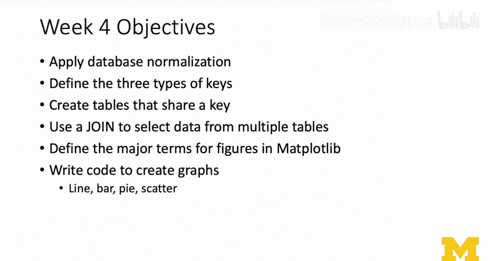
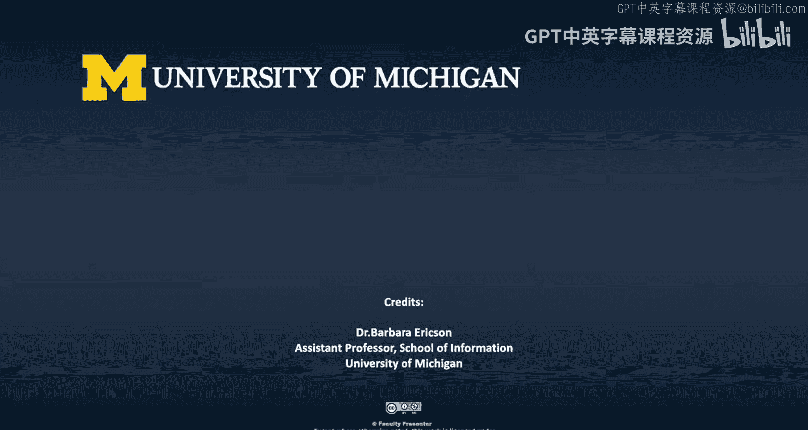

# 创造性编程：第四周：课程概述与目标 🎯

在本节课中，我们将要学习第四周的核心内容，包括数据库规范化的应用、键的定义与使用，以及如何使用Matplotlib库创建各种图表。

欢迎来到本课程的最后一周。本周你将学习如何应用数据库规范化。这是一个将数据库中的内容分解为不同实体或类的过程。然后，你需要确保数据库中不存在重复的字符串数据。

你将学习定义三种类型的键：外键、逻辑键和主键。你将能够创建共享键的表，并使用JOIN操作从多个表中选取数据。

此外，你将学习Matplotlib图表库中的主要术语。你将编写代码来创建不同类型的图表或图形，例如折线图、条形图、散点图和饼图。

这些都是非常实用的技能。祝你本周学习顺利。

---

## 总结

本节课中我们一起学习了第四周的学习目标。我们了解到，本周的重点是掌握数据库规范化的方法、理解并运用不同的键来关联数据表，以及使用Matplotlib库进行数据可视化，绘制多种类型的图表。这些技能对于构建结构清晰、高效的数据应用至关重要。