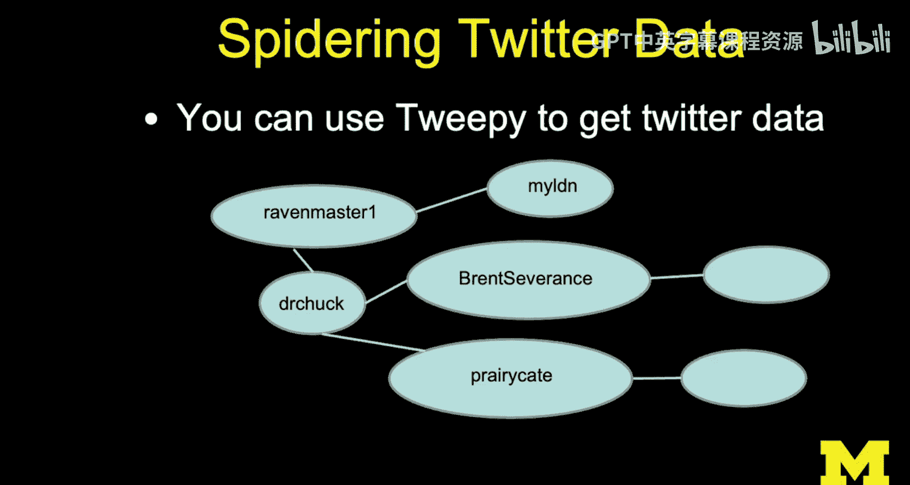

# 46：Twitter爬虫入门 🕷️

在本节课中，我们将学习如何使用数据库来爬取Twitter数据。这个程序会从一个特定的Twitter用户开始，逐步收集其数据，然后找到该用户的五位好友，并对每位新用户重复此过程。你可以想象，这个过程可能会持续很长时间，并且会在用户之间形成许多相互关联。请先阅读本章内容，之后我们将进行更详细的讨论。

## 概述


我们将构建一个Twitter数据爬虫。其核心思路是：从一个“种子”用户开始，获取其数据，然后找到他的五位好友，再对这五位好友中的每一位重复同样的操作。这个过程会像蜘蛛网一样扩散开来，逐步建立起一个用户关系网络。

## 爬虫工作原理


上一节我们介绍了项目的整体目标，本节中我们来看看爬虫具体是如何工作的。

程序的核心是一个循环。它从一个初始用户（例如 `drchuck`）开始，然后执行以下步骤：

以下是爬虫工作的基本步骤：

1.  检查数据库中是否已存在该用户。如果不存在，则从Twitter API获取该用户的个人信息并存入数据库。
2.  从该用户的Twitter时间线中获取其最新发布的推文，并存入数据库。
3.  获取该用户的关注者（好友）列表。
4.  从关注者列表中，选择尚未在数据库中的前五位用户。
5.  将这五位新用户加入待处理队列。
6.  从队列中取出下一个用户，重复上述过程。

这个过程可以用一个简单的**伪代码**循环来描述：

```python
while len(queue) > 0:
    user = queue.pop(0) # 从队列中取出一个用户
    if user not in database: # 如果用户不在数据库中
        add_user_to_database(user) # 获取并存储用户信息
        add_tweets_to_database(user) # 获取并存储用户推文
    friends = get_friends(user) # 获取用户的好友列表
    new_friends = [f for f in friends if f not in database][:5] # 筛选出前5个新好友
    queue.extend(new_friends) # 将新好友加入队列
```

## 数据结构与数据库

为了高效地存储和查询数据，我们需要一个数据库。我们将使用SQLite数据库，并创建三张表。

以下是数据库中的核心表结构：

*   **`People` 表**：存储用户信息。
    *   `id`：主键，自增整数。
    *   `name`：用户的真实姓名。
    *   `twitter_id`：用户在Twitter平台上的唯一ID。
    *   `retrieved`：一个布尔值（0或1），标记该用户的数据是否已被爬取过。
*   **`Follows` 表**：存储用户之间的关注关系。
    *   `from_id`：关注者的ID（对应 `People` 表中的 `id`）。
    *   `to_id`：被关注者的ID（对应 `People` 表中的 `id`）。
*   **`Tweets` 表**：存储用户发布的推文。
    *   `id`：主键，自增整数。
    *   `people_id`：发布此推文的用户ID（对应 `People` 表中的 `id`）。
    *   `tweet`：推文的文本内容。
    *   `created_at`：推文的发布时间。

## 关键代码逻辑解析

理解了数据结构后，我们来看看程序中的几个关键函数是如何运作的。

**1. 添加新用户 (`add_user`)**
这个函数接收一个Twitter用户ID，首先检查该用户是否已在 `People` 表中。如果不在，则调用Twitter API获取用户信息，并插入一条新记录，同时将 `retrieved` 字段设为0（表示其好友和推文尚未被爬取）。

**2. 获取并存储推文 (`add_tweets`)**
这个函数为一个指定的用户获取其最新的推文。它通过API获取推文列表，然后遍历列表，将每条推文的文本和发布时间插入到 `Tweets` 表中。

**3. 获取并处理好友 (`get_friends`)**
这是爬虫扩散的核心。函数为一个用户获取其关注者列表。对于列表中的每个关注者：
*   调用 `add_user` 确保该关注者已在 `People` 表中。
*   在 `Follows` 表中插入一条从当前用户到该关注者的关系记录。
*   如果该关注者是“新”用户（即其 `retrieved` 字段为0），则将其加入待处理的“朋友”列表。程序最终会返回这个新用户列表的前5位。

## 主循环与流程控制

最后，我们来看驱动整个爬虫运行的主循环。程序从一个种子用户开始，将其放入一个待处理列表（`friends`）。

以下是主循环的控制流程：



1.  从 `friends` 列表前端取出一个用户。
2.  如果该用户的 `retrieved` 标志为0（表示未处理）：
    *   打印处理信息。
    *   调用 `add_tweets` 获取其推文。
    *   调用 `get_friends` 获取其好友，并将返回的新好友列表添加到 `friends` 列表的末尾。
    *   将该用户的 `retrieved` 标志更新为1（表示已处理）。
3.  如果该用户的 `retrieved` 标志已为1，则跳过处理。
4.  检查 `friends` 列表是否为空，或已处理的用户数是否达到预设限制（如75人）。如果满足任一条件，则退出循环；否则，回到步骤1。

这个设计确保了爬虫会优先处理“新发现”的用户，并以广度优先的方式在网络中探索。


## 总结

本节课中我们一起学习了如何构建一个Twitter关系网络爬虫。我们掌握了其核心工作流程：从种子用户出发，获取其推文和好友，然后迭代地处理新发现的好友。我们还设计了相应的数据库结构（`People`， `Follows`， `Tweets` 表）来存储用户信息、社交关系和内容。通过主循环中的队列机制和状态标志（`retrieved`），我们实现了爬虫的自动化运行与流程控制。这个项目综合运用了API调用、数据库操作和循环控制，是创造性编程的一个很好的实践。