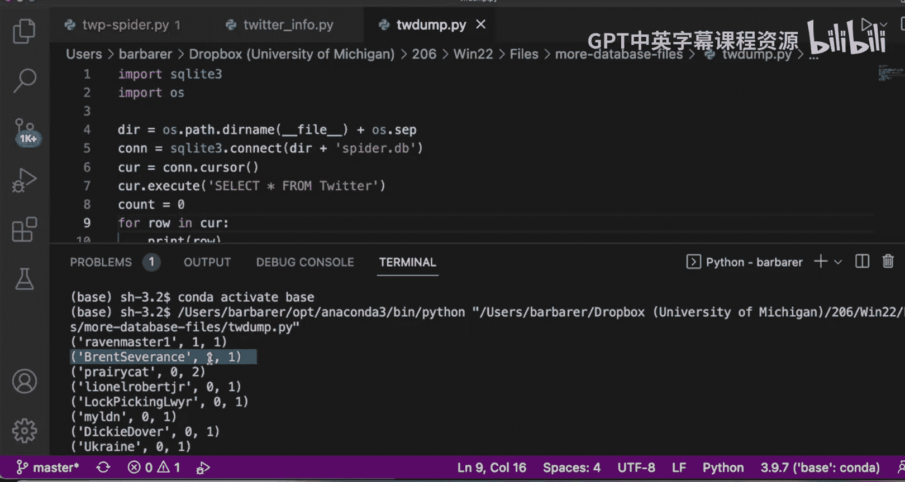

# 创造性编程：47：Twitter爬虫代码实现 🕷️

在本节课中，我们将学习如何实现一个Twitter数据爬虫。我们将使用Tweepy库来访问Twitter API，并将获取到的数据存储到SQLite数据库中。整个过程包括设置授权、建立数据库连接、获取用户的朋友列表以及更新数据库记录。

---

## 概述

在开始爬取Twitter数据之前，你需要先安装Tweepy库，并获取一个Twitter开发者账户。本教程将指导你完成这些步骤，并展示如何编写代码来获取和存储Twitter用户的朋友信息。

---

## 安装与授权设置

在爬取Twitter数据之前，首先需要安装Tweepy库，这是一个用于访问Twitter的API。接着，你需要获取一个Twitter开发者账户。请按照文件中的指示操作，其中一项是获取Bearer Token，你需要将其放入名为`twitter_info.py`的文件中。

将授权信息分离出来是最佳实践。我们在代码中导入`twitter_info`文件，然后使用该文件中的信息进行授权，创建Bearer Token，并利用它来创建API对象。

这样做的好处是避免将授权信息硬编码在共享给其他人的文件中，从而提高了安全性。

---

## 数据库设置

接下来，我们设置数据库并获取访问权限。代码在与执行文件相同的目录中查找数据库文件，并创建到该文件的连接。我们使用`spider.db`作为数据库文件名，创建游标对象，并执行`CREATE TABLE IF NOT EXISTS`语句。

由于我们可能会多次停止和重启代码，因此需要确保每次运行时不会删除表，否则将无法添加新数据。通过使用`IF NOT EXISTS`，第一次运行时表会被创建，后续运行时则不会改变表结构。

---

## 用户输入与数据获取

在`while True`循环中，我们要求用户输入一个Twitter用户名，或者直接按回车键，或者输入“quit”。如果用户输入“quit”，则退出循环。如果用户直接按回车键（输入长度小于1），则从数据库中随机选择一个尚未检索过的用户。

我们使用`LIMIT 1`来限制查询结果，并通过`fetchone()`获取一个元组，然后使用索引`[0]`提取第一个元素。

接着，我们打印出正在为该用户名刷新朋友列表的信息。无论用户是输入了用户名还是我们从数据库中选择了未访问过的用户，都会执行此操作。

---

## 获取与更新朋友列表

我们获取该用户的朋友列表，并更新数据库中的记录，标记该用户的朋友列表已被检索。然后，我们循环遍历前五个朋友（或朋友列表的长度，取较小值）。

在循环中，我们获取当前索引对应的朋友信息，并提取其用户名。接着，检查该用户是否已存在于数据库中。如果存在，则更新该用户的出现次数；如果不存在，则将其插入数据库。

完成插入或更新操作后，我们提交更改。

---

## 运行示例

让我们运行代码看看会发生什么。程序会要求输入一个用户名，我输入了“DrChuck”（他是《Python for Everyone》电子书的原作者，我将其改编成了交互式版本）。

程序获取了他的五个朋友，然后我输入“quit”退出。接着，我们查看数据库中的数据，发现DrChuck的五个朋友已被记录，且他们的“已检索”状态均为0，表示尚未获取他们的朋友列表。

如果我们再次运行程序，并直接按回车键，程序会从数据库中选择一个未访问过的用户（例如“RavenMaster1”），并尝试获取其五个朋友。这次，我们成功获取了四个新账户和一个已存在的账户。

再次查看数据库，我们可以看到原始的五条记录，以及新增的朋友记录。同时，数据库更新了“RavenMaster1”和“BretSeverance”的“已检索”状态为1，而“PrairieCrt”的出现次数被更新为2，表示有两个用户共享了这个朋友。

---

## 总结

本节课我们一起学习了如何实现一个Twitter数据爬虫。我们涵盖了从安装Tweepy库和设置Twitter开发者账户，到编写代码获取用户朋友列表并存储到SQLite数据库的完整流程。通过分离授权信息、使用条件创建表以及处理用户输入，我们构建了一个可以持续运行并扩展的爬虫程序。