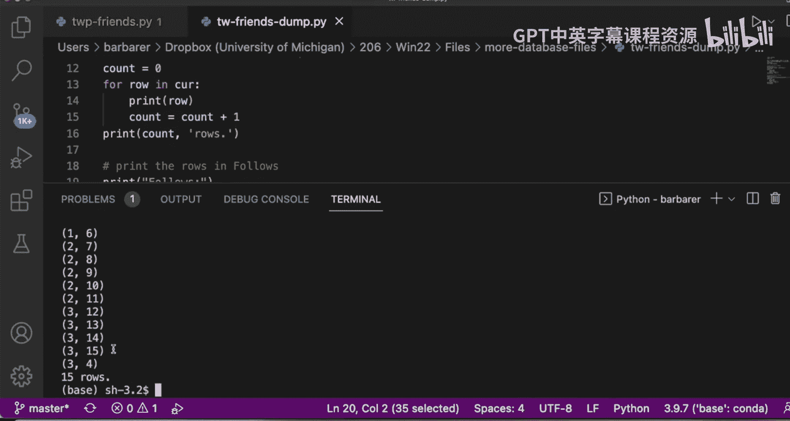

# 创造性编程：48：多表操作代码解析 🕷️


在本节课中，我们将学习如何修改网络爬虫程序，使其能够记录“谁关注了谁”的关系，并将数据存储在两个独立的数据库表中。我们将详细解析实现这一功能的代码。

---

## 概述

上一节我们介绍了基本的网络爬虫和数据存储。本节中，我们来看看如何将数据组织到两个关联的表中：一个存储用户信息（`people`），另一个存储关注关系（`follows`）。这种设计能更清晰地分离实体和关系，是数据库建模的常见实践。

## 代码结构与初始化

首先，代码进行了一些必要的导入和初始化设置。这与之前的爬虫类似，包括设置API授权、建立数据库连接和创建游标。

```python
import sqlite3
import tweepy
# ... 其他导入和授权设置

conn = sqlite3.connect('spider.sqlite')
cur = conn.cursor()
```

为了保证程序可以多次运行而不出错，代码使用了`CREATE TABLE IF NOT EXISTS`语句。首次运行时创建表，后续运行时则直接使用已存在的表。

以下是创建两个表的SQL语句：

```sql
-- 创建用户表
CREATE TABLE IF NOT EXISTS People
    (id INTEGER PRIMARY KEY, name TEXT UNIQUE, retrieved INTEGER)

-- 创建关注关系表
CREATE TABLE IF NOT EXISTS Follows
    (from_id INTEGER, to_id INTEGER, UNIQUE(from_id, to_id))
```

在`People`表中，`id`是主键，`name`必须唯一。在`Follows`表中，`from_id`和`to_id`的组合被设置为唯一，这确保了不会记录重复的关注关系。在数据库设计初期定义这些约束（主键、唯一键）非常重要，可以有效防止数据重复。

## 主循环逻辑

程序的主循环负责处理用户输入并获取数据。逻辑与之前类似，但增加了对多表的操作。

1.  **用户输入**：程序提示用户输入一个Twitter用户名，或直接按回车让程序自动选择一个未爬取的用户。
2.  **退出机制**：如果用户输入“quit”，则退出循环。
3.  **选择目标用户**：如果用户直接按回车，程序会从`People`表中选择一个`retrieved`字段为0（即未爬取过其关注列表）的用户。

```python
cur.execute('SELECT id, name FROM People WHERE retrieved = 0 LIMIT 1')
try:
    row = cur.fetchone()
    # ... 处理选中的用户
```

## 插入用户与处理关注者

这是代码的核心部分，涉及向两个表中插入数据。

1.  **确保用户存在**：无论是用户输入的还是程序自动选择的用户名，程序都首先尝试将其插入`People`表。这里使用了`INSERT OR IGNORE`语句。

    ```sql
    INSERT OR IGNORE INTO People (name, retrieved) VALUES ( ?, 0)
    ```

    这条命令会尝试插入数据，但如果`name`违反了唯一性约束（即用户已存在），则会忽略此次插入，而不会报错。这对于避免重复数据至关重要。

2.  **获取关注列表**：程序通过Twitter API获取目标用户的关注者列表。如果成功，则将该用户的`retrieved`字段更新为1，表示已爬取。

3.  **处理每个关注者**：程序遍历获取到的关注者列表（数量上限为5个或列表长度）。对于每个关注者：
    *   检查该关注者是否已存在于`People`表中。
    *   如果不存在，则使用`INSERT OR IGNORE`将其插入`People`表。
    *   无论新旧，都获取其在`People`表中的`id`。
    *   将“关注关系”（即`from_id`（目标用户）关注`to_id`（该关注者））插入`Follows`表。这里同样使用了`INSERT OR IGNORE`来防止重复关系。

    ```python
    friend_id = cur.lastrowid # 获取新插入用户的ID
    countnew = countnew + 1
    cur.execute('INSERT OR IGNORE INTO Follows (from_id, to_id) VALUES (?, ?)', (id, friend_id))
    ```

## 数据提交与程序运行

以下是程序结束前的收尾工作：

*   **打印统计信息**：程序会打印本次运行中新添加的用户数量和已存在的用户数量。
*   **提交与关闭**：所有数据库操作完成后，必须执行`conn.commit()`来提交事务，确保数据写入磁盘，然后关闭游标和连接。

让我们尝试运行这个程序。首先输入“DrChuck”作为起始用户。程序会获取他的5个关注者并存入数据库。

退出后，我们可以查询数据库。`People`表会显示用户信息及其`retrieved`状态（1表示已爬取其关注者）。`Follows`表则记录了关注关系，例如，前5条记录显示有5个用户关注了DrChuck（`from_id`为DrChuck的`id`）。

再次运行程序，直接按回车，程序会自动选择一个`retrieved`为0的用户（例如第二个用户）并获取其关注者。查询数据库会发现，`People`表中增加了新用户，`Follows`表中也增加了新的关注关系，并且可能存在跨用户的重复关注者，这体现了真实社交网络的复杂性。

---

## 总结




本节课中我们一起学习了如何构建一个使用多张数据库表的网络爬虫。关键点包括：
1.  使用`CREATE TABLE IF NOT EXISTS`和`INSERT OR IGNORE`来优雅地处理表的创建和重复数据的插入。
2.  通过定义**主键**和**唯一约束**来保证数据的完整性和一致性。
3.  将“用户”实体和“关注”关系分离到不同的表中，使数据模型更清晰、更易于管理和扩展。
4.  整个程序流程涵盖了从用户输入、API调用、数据校验到多表关联存储的完整过程，是一个实用的数据库应用示例。