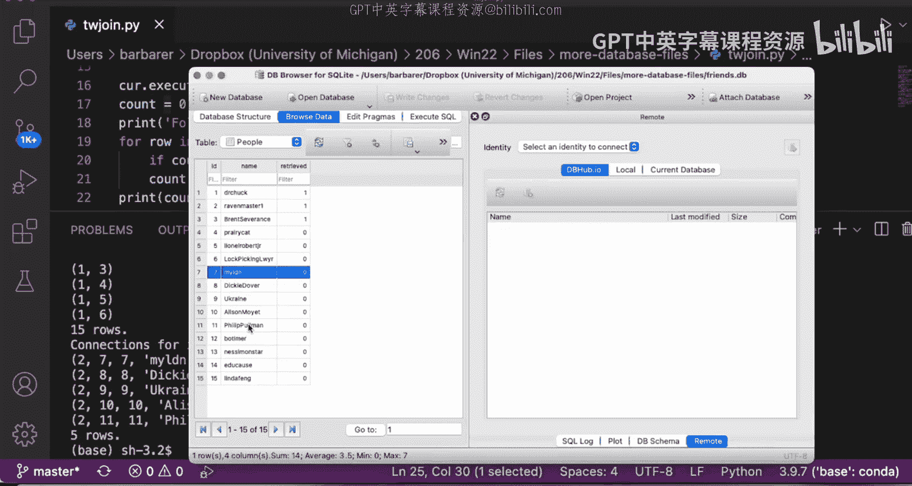

# 49：JOIN语句应用 🧩


在本节课中，我们将学习如何使用SQL的`JOIN`语句，从数据库的多个表中组合数据。`JOIN`是处理关系型数据库时一个非常强大的工具，它允许我们将分散在不同表中的数据临时连接起来，以便进行查询和分析。

## 概述

上一节我们介绍了数据库的基本查询操作。本节中，我们来看看如何通过`JOIN`语句，将“people”表和“follows”表中的数据关联起来，从而获取更丰富的信息。

## 代码实现与数据连接

首先，我们需要编写代码来执行一个`JOIN`查询。以下是实现这一过程的步骤：

1.  导入必要的模块。
2.  确定当前文件所在目录，并据此定位数据库文件。
3.  建立与数据库的连接，并获取一个游标（cursor）来执行SQL语句。
4.  分别查询“people”表和“follows”表，以了解基础数据。
5.  执行一个`JOIN`查询，将两个表的数据按特定条件关联起来。

以下是实现上述步骤的核心代码：

```python
import sqlite3
import os

# 获取当前文件目录并定位数据库
dirname = os.path.dirname(__file__)
database_path = os.path.join(dirname, ‘your_database.db’)

# 连接数据库并获取游标
conn = sqlite3.connect(database_path)
cur = conn.cursor()

# 查询people表的前几条记录
cur.execute(‘SELECT * FROM people LIMIT 5’)
people_data = cur.fetchall()
print(“People Table:”, people_data)


# 执行JOIN查询
cur.execute(‘’’
    SELECT *
    FROM follows
    JOIN people
    ON follows.to_id = people.id
    WHERE follows.from_id = 2 AND follows.count = 0
    LIMIT 5
‘’’)
joined_data = cur.fetchall()
print(“Joined Result:”, joined_data)

# 关闭连接
cur.close()
conn.close()
```

## 理解JOIN查询结果

运行上述代码后，我们得到了组合后的数据。为了更直观地理解`JOIN`的工作原理，我们也可以使用DB Browser这样的工具查看。

在DB Browser中查看“follows”表，我们看到`WHERE`子句`follows.from_id = 2`筛选出的记录，其`to_id`为27、28、29。

同时，在“people”表中，ID为27、28、29对应的正是这些用户的信息。

`JOIN`语句所做的工作，就是根据`ON follows.to_id = people.id`这个条件，将“follows”表中符合条件的每一行，与“people”表中`id`匹配的那一行数据横向拼接在一起，形成一个临时的、更宽的结果表。

## JOIN的强大之处

数据库设计通常遵循“规范化”原则，将数据拆分到不同的表中以避免冗余。`JOIN`语句的强大之处在于，它能根据需要，临时地将这些分散的数据重新组合起来。这样，我们就能像操作单个表一样，对关联后的完整数据集进行查询、分析和报告，从而获得深层次的洞察。



## 总结


本节课中我们一起学习了SQL `JOIN`语句的应用。我们通过具体代码演示了如何连接两个表，并解释了`JOIN`操作在数据库“规范化”设计背景下所起的关键作用——它让我们能够灵活地重组数据，以满足复杂的查询需求。