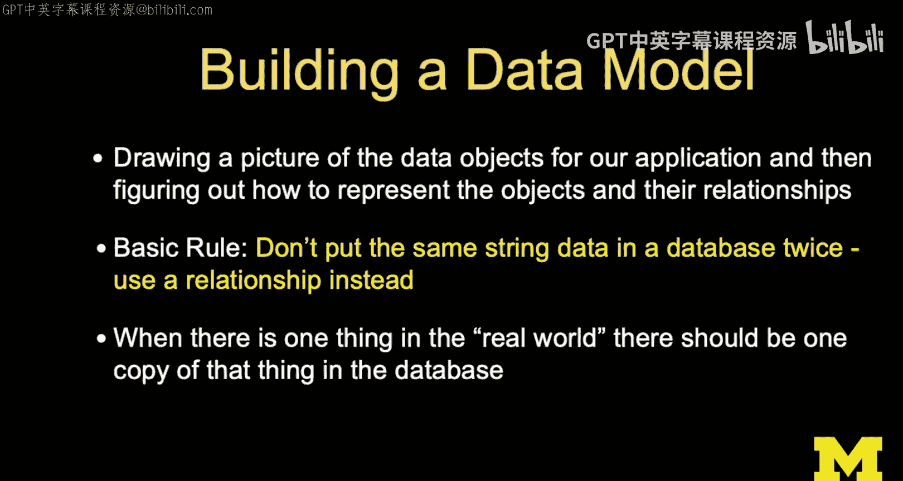
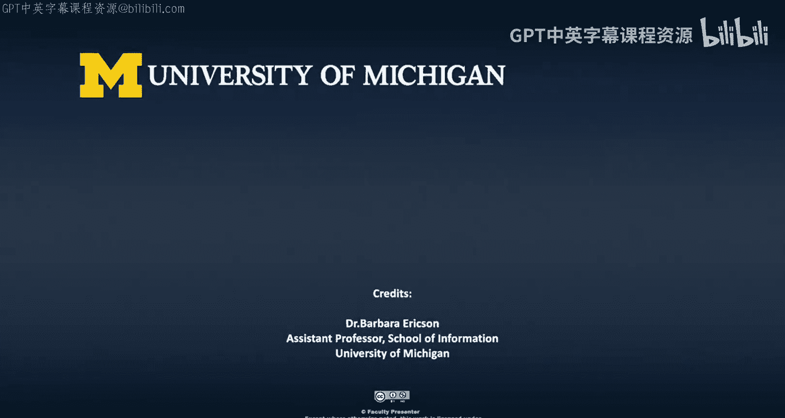

# 创造性编程：50：数据库设计目标 🎯

在本节课中，我们将探讨数据库设计的基本目标。我们将学习如何避免常见的设计错误，并理解如何构建一个清晰、易于理解的数据模型。

---

数据库设计是一门融合了技巧与经验的艺术。我们的核心目标是避免那些非常糟糕的设计错误，并构建出清晰、易于理解的结构。性能优化通常是后续步骤。

上一节我们介绍了数据库设计的重要性，本节中我们来看看具体的设计原则。

## 避免数据冗余

一个关键原则是避免在数据库中重复存储字符串数据。这意味着，对于现实世界中的同一个实体，在数据库里只应保存一份副本。

以下是实现这一目标的方法：
*   不要将同一字符串数据存入数据库两次。
*   使用关系（Relationship）和主键（Primary Key）来引用数据。通常，主键是数字（如ID），它关联着对应的字符串数据。
*   通过ID来引用字符串数据，而不是直接复制它。

这样做的好处是：
*   **易于维护**：当需要修改数据时，只需在一个地方更新，无需四处查找和更改所有副本。
*   **便于查询**：数据唯一性能让检索和查找操作变得更简单、更高效。

---

本节课中我们一起学习了数据库设计的核心目标：避免数据冗余。我们了解到，通过使用主键和关系来引用数据，而非直接复制字符串，可以构建出更清晰、更易于维护的数据库结构。记住，现实世界中的一个实体，在数据库中最好只对应一份数据副本。