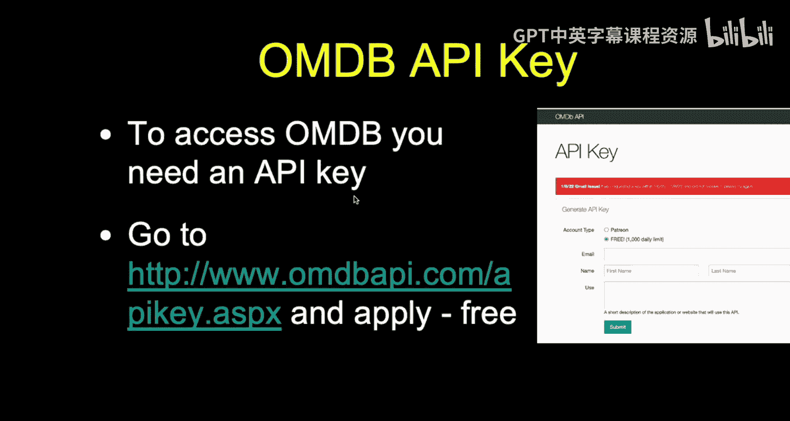
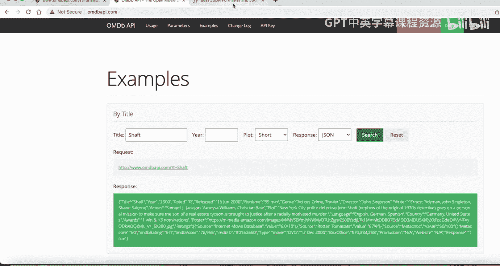
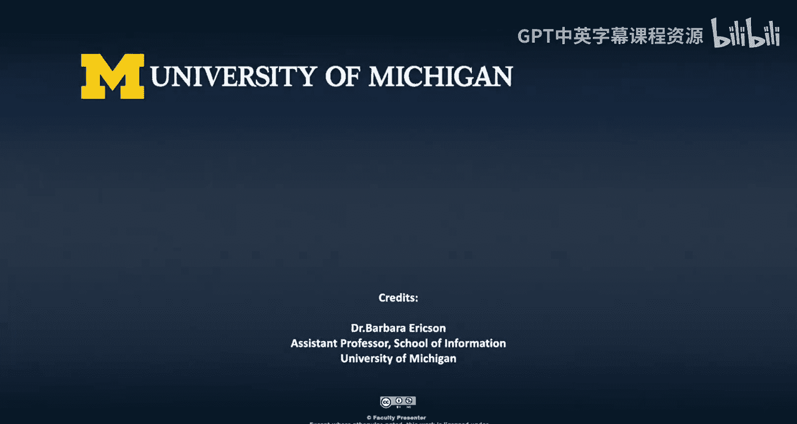

# 创造性编程：51：OMDB接口解析 🎬


在本节课中，我们将学习如何使用OMDB API来获取电影数据。我们将从如何获取API密钥开始，逐步讲解如何构建请求URL、解析返回的JSON数据，并最终提取出我们所需的信息。

## 获取API密钥 🔑



要使用OMDB API，首先需要获取一个API密钥。

以下是获取API密钥的步骤：
1.  访问OMDB网站（`www.omdbapi.com`）。
2.  点击“API Key”链接。
3.  在表单中填写你的邮箱地址、名、姓以及使用目的（例如，可以填写“用于在线课程”）。
4.  点击“Submit”提交表单。
5.  提交后，你将收到一个专属的API密钥。

## 构建API请求 🌐

上一节我们获得了访问OMDB的“钥匙”，本节中我们来看看如何使用它来请求数据。

使用API的基本方式是访问一个特定的URL。你需要在URL的问号（`?`）后面添加参数。最基本的参数是你的API密钥。

核心请求URL结构如下：
```
http://www.omdbapi.com/?apikey=你的API密钥&其他参数
```

除了`apikey`，OMDB API还支持许多其他参数来筛选数据。例如，如果你想搜索特定电影，可以使用`t`（代表title，标题）参数。

以下是几个常用的参数示例：
*   `t`：按电影标题搜索（例如，`&t=Shaft`）。
*   `y`：按年份筛选。
*   `i`：按IMDb ID搜索。

例如，要搜索电影《Shaft》（2000年版），可以构建如下URL：
```
http://www.omdbapi.com/?apikey=你的密钥&t=Shaft&y=2000
```

## 解析返回的JSON数据 📊

当我们向OMDB发送请求后，它会返回一个JSON格式的数据。JSON是一种易于机器和人类阅读的数据交换格式。

以下是请求《Shaft》电影数据可能返回的JSON示例（经过格式化以便阅读）：
```json
{
  "Title": "Shaft",
  "Year": "2000",
  "Rated": "R",
  "Actors": "Samuel L. Jackson, Vanessa Williams, Jeffrey Wright, Christian Bale",
  "Ratings": [
    {
      "Source": "Internet Movie Database",
      "Value": "6.1/10"
    },
    {
      "Source": "Rotten Tomatoes",
      "Value": "69%"
    }
  ]
}
```
从上面的数据可以看出：
*   返回的数据本质上是一个**字典**（在Python中）。
*   字典中包含`Title`（标题）、`Year`（年份）、`Rated`（分级）等键值对。
*   `Actors`（演员）键对应的值是一个**字符串**，里面包含了用逗号分隔的多个演员名字。
*   `Ratings`（评分）键对应的值是一个**列表**。列表中的每个元素又是一个**字典**，包含了评分来源（`Source`）和分数（`Value`）。

为了更直观地查看和理解复杂的JSON结构，你可以使用在线JSON格式化工具（如 `jsonformatter.org`），将原始的JSON数据粘贴进去，它会帮你整理成清晰的树状结构，方便你找到需要提取的数据路径。



## 总结 📝




本节课中我们一起学习了OMDB API的基本使用方法。我们首先了解了如何获取必要的API密钥，然后学习了如何通过添加参数来构建请求URL以查询特定电影信息。最后，我们解析了API返回的JSON数据格式，认识到它由字典、列表和字符串等多种结构组成，这为我们后续在Python程序中提取“标题”、“演员”或“评分”等具体信息打下了基础。