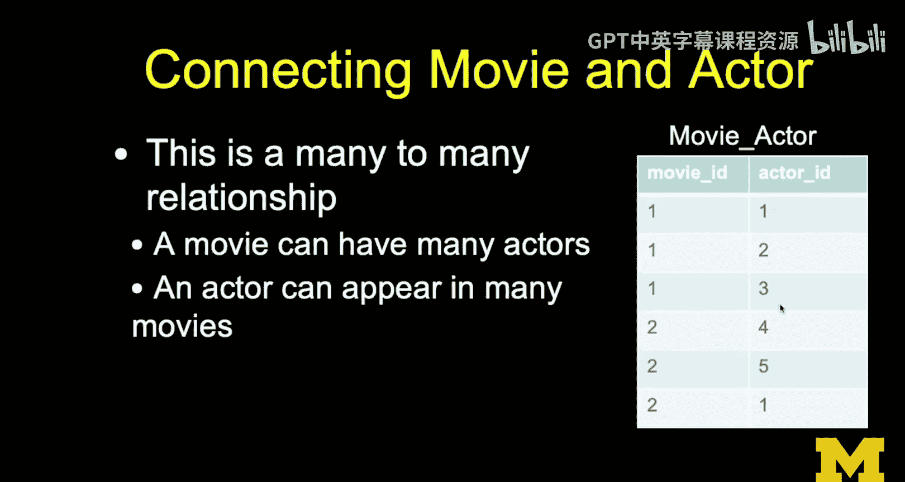

# 52：OMDB数据表设计 🎬


在本节课中，我们将学习如何为来自OMDB（互联网电影数据库）的数据设计数据库表。我们将探讨数据库规范化的基本原则，特别是如何处理“多对多”关系，以避免数据冗余并确保数据完整性。

---

## 从单一表开始

如果我们处理来自OMDB的数据，并试图弄清楚如何将其放入数据库表中，人们通常从一张表开始。

例如，如果我们想存储电影的标题、年份和演员，可能会设计如下表结构：
*   **Title**: 字符串
*   **Year**: 数字或字符串
*   **Actors**: 字符串（一个用逗号分隔的演员列表）

**代码示例：**
```sql
CREATE TABLE movies_naive (
    title VARCHAR(255),
    year INT,
    actors TEXT
);
```

---

## 识别问题与实体

然而，请注意，上述设计违反了数据库规范化的一个核心原则：我们不希望在数据库中存在重复的字符串。

例如，演员“塞缪尔·L·杰克逊”可能会在表中出现多次，这是不理想的。更重要的是，我们实际上在讨论不同的**实体**。

审视数据时，需要做的一件事是判断数据属于哪种事物或实体。标题和年份都属于**电影**这个实体。而演员是另一种事物，是**人**，是一个不同的实体。因此，我们需要将其分离出来。

我们希望有一个电影表和一个演员表，以避免重复的字符串数据。

---

## 设计分离的表

因此，我们将数据拆分开：
*   **电影表**：存储电影数据。
*   **演员表**：存储演员数据。

我们需要为每个表分配一个**主键**。因为可能存在同名演员，也可能存在同名但不同年份的电影。为了标识它们的唯一性，我们可以规定标题和年份的组合必须是唯一的。

**公式/概念：**
*   **主键 (Primary Key)**: 表中每条记录的唯一标识符。
*   **实体 (Entity)**: 数据库中可被唯一标识的对象或概念，如“电影”、“演员”。

---

## 处理多对多关系

现在，我们有了电影表和演员表，它们代表了独立的实体。但问题是：如何将电影和演员关联起来？

我们知道，一部电影可以有多位演员，一位演员也可以参演多部电影。这被称为**多对多关系**。

为了处理这种关系，我们创建第三个表。这个表只使用来自电影表和演员表的ID。

**代码示例：**
```sql
CREATE TABLE movie_actor (
    movie_id INT,
    actor_id INT,
    FOREIGN KEY (movie_id) REFERENCES movies(id),
    FOREIGN KEY (actor_id) REFERENCES actors(id)
);
```

对于一部电影，我们可以在这个关联表中添加多条记录，每条记录对应电影中的一位演员（通过`actor_id`关联）。这样，我们就实现了数据的规范化。

---

## 总结与优势

本节课中，我们一起学习了为OMDB数据设计数据库表的过程。

我们首先从单一表设计开始，然后识别出其中的数据冗余问题。通过区分“电影”和“演员”两个不同的实体，我们将它们拆分到独立的表中，并为每个表设置了主键。最后，为了处理电影和演员之间的“多对多”关系，我们创建了一个使用双方ID的关联表。




这种方式的好处是：
1.  **数据规范化**：消除了重复数据（如演员姓名）。
2.  **使用主键**：用数字ID高效地代表对象。
3.  **关系清晰**：通过关联表明确表达了“多对多”关系。
4.  **查询灵活**：后续可以使用SQL的`JOIN`操作，轻松地将这些分散的数据重新组合在一起进行查询。


通过这样的设计，我们建立了一个结构清晰、高效且易于维护的数据库模型。🎯