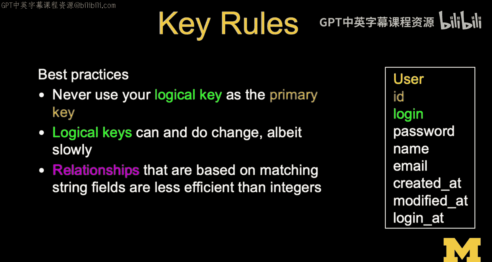

# 创造性编程：53：键类型与最佳实践 🔑


在本节课中，我们将要学习数据库中三种不同类型的键，并了解在数据库设计中使用键的最佳实践。理解这些概念对于构建高效、可维护的数据模型至关重要。

## 三种键类型

上一节我们介绍了数据库的基本概念，本节中我们来看看数据库中三种核心的键类型。

**主键**：这是我们一直在使用的一种键。它通常是一个自动递增的整数，被分配给数据库中的每一个实体。在代码中，这通常表示为：
```python
id INTEGER PRIMARY KEY AUTOINCREMENT
```

**逻辑键**：这是外部世界通常用于查找数据的键。例如，对于一张专辑，你可能会使用它的标题来查找。然而，逻辑键并不适合作为主键，因为可能存在两张标题相同的专辑，这时你可能需要通过年份等其他信息来区分。

**外键**：这是另一个整数键，它是另一个表中的主键。例如，在专辑表中，`artist_id` 字段就是一个外键，因为它对应的是艺术家表中的主键。

## 使用键的最佳实践

了解了键的类型后，以下是关于如何使用键的一些最佳实践建议。

*   **不要使用逻辑键作为主键**：应为每个表创建一个独立的、自动递增的主键。因为逻辑键可能会发生变化，例如，用户的用户名可能会随着时间而改变。
*   **优先使用整数键建立关系**：基于字符串字段进行匹配和关联的效率，通常低于使用整数键。因此，最佳实践是创建整数类型的主键，并使其与逻辑键区分开来。



## 总结


本节课中我们一起学习了数据库中的三种键类型：主键、逻辑键和外键。我们明确了最佳实践是创建独立的整数主键，而不是依赖可能变化的逻辑键。这有助于确保数据库的稳定性、高效性和易于维护性。