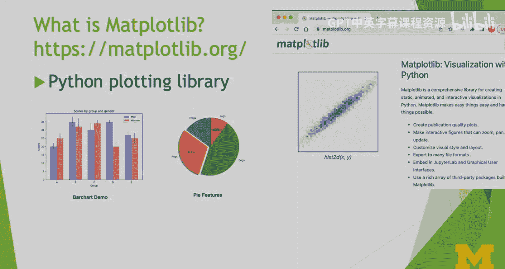

# 54：Matplotlib基础 📊

在本节课中，我们将要学习Python中一个强大的绘图库——Matplotlib。我们将了解它是什么，以及如何使用它来创建一些常见的图表。

## 什么是Matplotlib？ 🤔

Matplotlib是一个Python绘图库，可用于创建多种常见图表。它非常易于使用，可以轻松制作简单的图表。

上一节我们介绍了Matplotlib的基本概念，本节中我们来看看它能创建哪些类型的图表。

以下是Matplotlib可以轻松创建的一些图表类型：
*   条形图
*   饼图
*   散点图
*   折线图

接下来，我们将向您展示如何使用Matplotlib来创建这些图表。