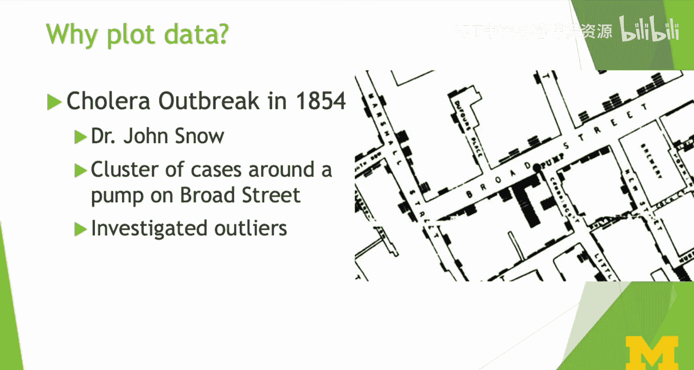

# 55：数据可视化意义 📊

在本节课中，我们将要学习数据可视化的核心目的与意义。通过一个经典的历史案例，我们将理解为何将数据转化为图表是揭示隐藏信息、发现规律和验证假设的强大工具。

---

我们绘制数据图，是为了理解那些难以通过原始数据直接观察到的关系和模式。

如果你只有两个数据点，你不需要绘制图表。但当你拥有大量数据时，可视化会变得非常有用。

以下是数据可视化的一个经典历史案例：

*   **背景**：1854年，伦敦爆发了一场霍乱疫情。
*   **行动**：一位名叫约翰·斯诺的医生开始绘制病例地图。
*   **可视化**：地图上的每个病例都用一条短线标记。
*   **发现**：从地图上可以清晰地看到，病例异常密集地聚集在某一个水泵周围，人们通常从那里取水。
*   **异常值分析**：斯诺医生也发现了一些离群病例（即不居住在该区域却感染霍乱的人）。经过调查，他发现这些人因为喜欢该水泵的水，所以即使不住在附近，也会让人把水送过去。
*   **反面证据**：同时，该区域也有一些居民没有感染霍乱。调查显示，这些人通常在拥有独立水源的地方工作，因此不使用这个可疑的水泵。
*   **结论**：这些通过地图可视化呈现的数据，帮助人们最终确定霍乱是通过受污染的水源传播的。

---

本节课中我们一起学习了数据可视化的根本意义。它不仅仅是绘制漂亮的图表，更是一种强大的分析工具，能够将抽象的数字转化为直观的空间关系，帮助我们识别模式、调查异常，并最终推导出深刻的结论，正如约翰·斯诺医生通过地图破解霍乱传播途径一样。