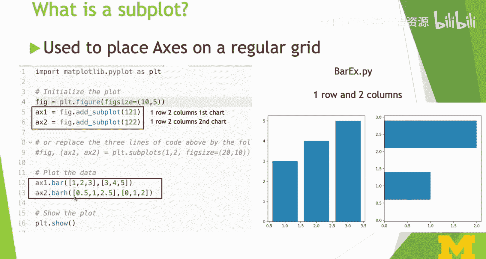
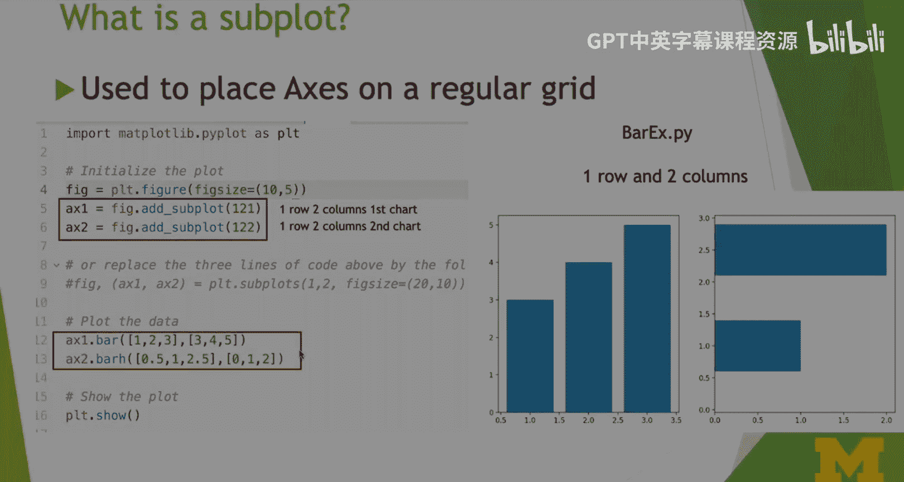

# 56：核心术语解析 📊

在本节课中，我们将学习 Matplotlib 库中的核心术语和概念。理解这些术语是创建和定制图表的基础。

## 概述

Matplotlib 是一个用于创建静态、动态和交互式可视化的 Python 库。要有效地使用它，首先需要理解其核心组件，如**图形（Figure）**、**坐标轴（Axes）**和**子图（Subplots）**。本节将逐一解析这些关键术语。

## 图形（Figure）与坐标轴（Axes）

上一节我们介绍了编程的基本概念，本节中我们来看看 Matplotlib 的核心结构。

**图形（Figure）** 是绘制图表的最顶层容器。你可以把它想象成一个画布或窗口，可以在上面放置一个或多个**坐标轴（Axes）**或**绘图（Plots）**。图形可以有标题。

在图形内部，你可以有**绘图（Plots）**，并且可以拥有多个绘图。这些绘图是可以通过坐标指定点的区域。你会有一个**坐标轴（Axes）**对象。

你可以参考这个展示图形解剖结构的 URL。在一个图形中，你可以有 X 轴和 Y 轴。你可以为这些轴设置 Y 轴标签和 X 轴标签。你可以有**主刻度（Major Ticks）**和**次刻度（Minor Ticks）**。总之，有很多不同的元素。

以下是图形中可以包含的主要元素列表：
*   **图形标题（Figure Title）**：整个图形的标题。
*   **图例（Legend）**：解释图表中颜色（例如这里的蓝色和橙色）或线型所代表含义的说明框。
*   **线图（Line Plot）**：由线段连接数据点形成的图表。
*   **标记（Markers）**：这些是图表上显示特定数据点的小图标，它们可以是不同的形状（如圆形、方形、三角形）。

因此，在使用图表时，需要考虑大量的词汇。

## 子图（Subplots）

在单个图形中创建多个图表时，就会用到**子图（Subplots）**。你可以有一个主绘图区域，也可以将其划分为多个子图区域。

当你创建子图时，会使用一个有趣的约定。例如，代码 `figure.add_subplot(1, 2, 1)` 表示：1行，2列，第一个图表。所以，这行代码创建了一个1行2列布局中的第一个图表。然后，你可以添加另一个子图：`add_subplot(1, 2, 2)` 表示1行2列布局中的第二个图表。

在示例中，对于第一个坐标轴（axes1），我们创建了一个垂直条形图。对于第二个坐标轴（axes2），我们创建了一个水平条形图。你可以看到，创建这些图表非常简单。我们只需要准备一些数据，然后调用 `bar` 函数制作条形图，或调用 `barh` 函数制作水平条形图即可。入门非常简单。

## 总结

本节课中我们一起学习了 Matplotlib 的核心术语。我们了解了**图形（Figure）** 作为顶层容器的作用，**坐标轴（Axes）** 作为实际的绘图区域，以及如何在单个图形中通过 **`add_subplot()`** 方法创建和管理多个**子图（Subplots）**。我们还简要介绍了图形中的其他元素，如标题、标签、刻度和图例。掌握这些基本概念是使用 Matplotlib 进行有效数据可视化的第一步。