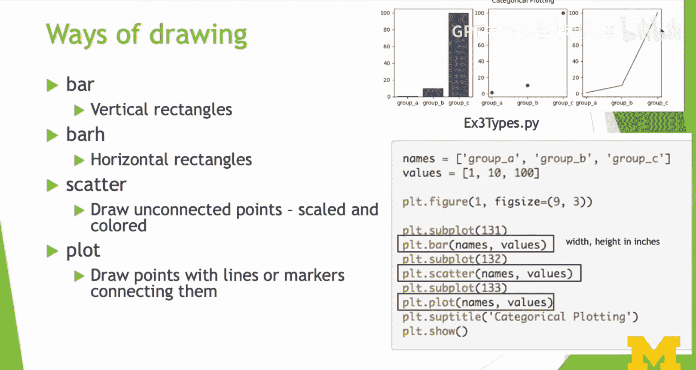

# 57：绘图实例展示 📊


在本节课中，我们将学习如何使用Python的Matplotlib库快速创建不同类型的图表。我们将通过一个简单的例子，展示如何在一个图形中并排绘制条形图、散点图和折线图。

---

上一节我们介绍了Matplotlib的基础概念，本节中我们来看看如何实际应用这些知识来创建组合图表。

首先，我们需要准备数据和设置图形。以下是创建图表的基本步骤：

以下是创建组合图表的代码示例：

```python
import matplotlib.pyplot as plt

# 准备数据
names = ['Group A', 'Group B', 'Group C']
values = [110, 100, 90]

# 创建一个图形，设置其大小为9x3（宽x高，单位英寸）
plt.figure(figsize=(9, 3))

# 创建第一个子图（1行，3列，第1个位置）
plt.subplot(1, 3, 1)
plt.bar(names, values)  # 绘制条形图
plt.title('Bar Plot')

# 创建第二个子图（1行，3列，第2个位置）
plt.subplot(1, 3, 2)
plt.scatter(names, values)  # 绘制散点图
plt.title('Scatter Plot')

# 创建第三个子图（1行，3列，第3个位置）
plt.subplot(1, 3, 3)
plt.plot(names, values)  # 绘制折线图
plt.title('Line Plot')

# 为整个图形添加一个总标题
plt.suptitle('Categorical Plotting')

# 显示图形
plt.show()
```

运行上述代码后，你将看到一个包含三个子图的图形窗口。总标题为“Categorical Plotting”。这三个子图从左到右分别是：
1.  **条形图**：使用垂直矩形表示数据。你也可以使用`plt.barh()`来创建水平条形图。
2.  **散点图**：用未连接的点来表示数据。
3.  **折线图**：用线或标记点连接数据点，展示趋势。




---


本节课中我们一起学习了如何使用Matplotlib的`subplot`功能在一个画布上创建多个图表。我们实践了绘制**条形图**、**散点图**和**折线图**，这是数据可视化中非常基础和有效的方法。通过这个简单的例子，你可以看到用几行代码就能生成清晰、多样的图表，这对于快速探索和展示数据非常有帮助。