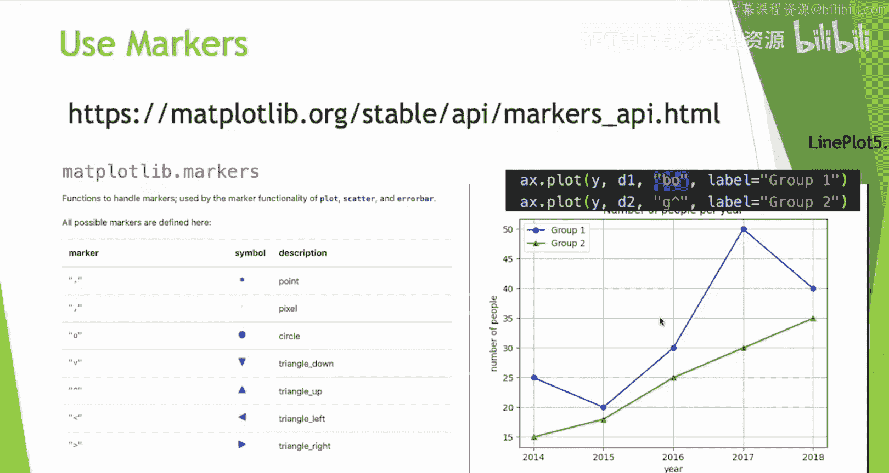

# 58：图表增强技巧 📈

在本节课中，我们将学习如何为Matplotlib图表添加图例、自定义线条颜色和标记，以增强图表的可读性和美观性。

## 添加图例

上一节我们介绍了基础的图表绘制，本节中我们来看看如何为包含多条数据线的图表添加图例。图例能帮助观众区分图表中不同线条所代表的数据系列。

如果你有一个折线图或普通图表，其中包含多条数据线，例如Y轴数据对应年份，而D1、D2等代表不同的数据系列，你可以为每条线添加标签，然后调用图例功能。

以下是具体步骤：
*   使用 `axis.plot(Y, D1, label='group 1')` 绘制第一条线并为其设置标签。
*   使用 `axis.plot(Y, D2, label='group 2')` 绘制第二条线并设置另一个标签。
*   最后，调用 `axis.legend()` 方法，图表上就会自动添加一个显示这些标签的图例框。

## 自定义线条颜色与样式

除了图例，我们还可以精细控制线条的外观，例如颜色和样式。Matplotlib提供了一套简洁的符号语言来实现这一点。

你可以通过在 `plot` 函数中使用特定的颜色和线条样式代码来定义线条外观。例如：
*   `‘b--‘` 表示蓝色虚线。
*   `‘g--‘` 表示绿色虚线。

## 使用数据点标记

为了让数据点的位置更加清晰可见，我们可以在线条上添加标记。标记符号同样使用简写代码。

以下是标记的示例：
*   `‘bo‘` 表示使用蓝色圆圈作为数据点标记。
*   `‘g^‘` 表示使用绿色上三角作为数据点标记。

你可以访问Matplotlib官方文档查看所有可用的标记类型列表，从而选择最适合的样式来突出显示你的数据点。

本节课中我们一起学习了如何通过添加图例、自定义线条颜色样式以及使用数据点标记来增强图表的表现力。这些技巧能让你的数据可视化结果更加专业和清晰。