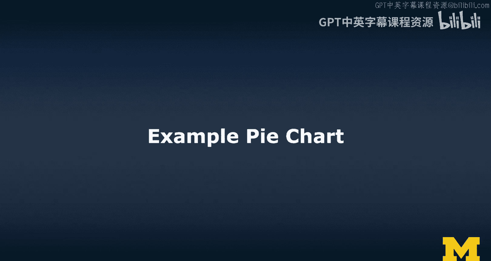
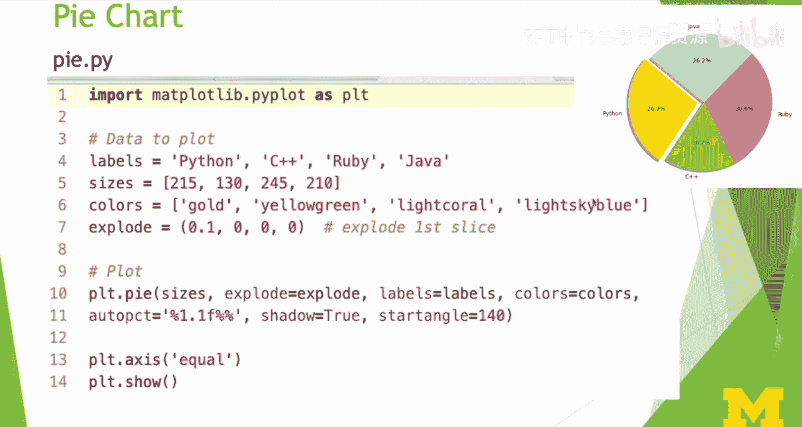
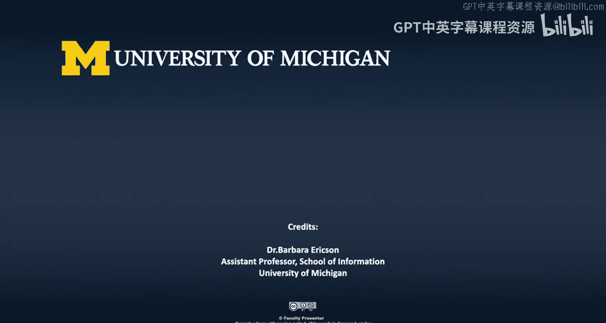

# 59：饼图绘制实例 📊

在本节课中，我们将学习如何使用Python的Matplotlib库来创建一个饼图。我们将通过一个具体的例子，了解如何定义数据、设置样式并最终生成一个带有百分比标签和阴影效果的饼图。




## 概述

饼图是一种常用的数据可视化方式，它通过扇形的大小来展示各部分数据在整体中的占比。我们将使用Matplotlib库中的`pie`函数来实现这一功能。

## 数据准备

首先，我们需要准备绘制饼图所需的数据。这包括标签、对应的数值、颜色以及我们想要“突出”显示的扇区。

以下是定义这些数据的代码：

```python
import matplotlib.pyplot as plt

# 定义数据
labels = ['Python', 'C++', 'Ruby', 'Java']
values = [40, 25, 20, 15]
colors = ['gold', 'lightcoral', 'lightskyblue', 'lightgreen']
explode = (0.1, 0, 0, 0)  # 突出显示第一个扇区（Python）
```

*   `labels`：一个列表，包含每个扇区的名称。
*   `values`：一个列表，包含每个扇区对应的数值。
*   `colors`：一个列表，定义每个扇区的颜色。
*   `explode`：一个元组，用于指定哪些扇区需要从饼图中心“突出”显示。`0.1`表示将第一个扇区向外移动一定距离。

## 绘制饼图

准备好数据后，我们就可以调用`plt.pie()`函数来绘制饼图了。这个函数提供了丰富的参数来控制饼图的外观。

以下是绘制饼图的代码：

```python
# 绘制饼图
plt.pie(values, labels=labels, colors=colors, explode=explode,
        autopct='%1.1f%%', shadow=True, startangle=140)

# 确保饼图是正圆形
plt.axis('equal')

# 显示图形
plt.show()
```

*   `autopct='%1.1f%%'`：这个参数用于在扇区内显示百分比。`%1.1f%%`表示格式化为保留一位小数的百分比。Matplotlib会自动根据`values`计算每个扇区的占比。
*   `shadow=True`：为饼图添加阴影效果，使其看起来更有立体感。
*   `startangle=140`：设置饼图的起始角度为140度，这会影响第一个扇区（Python）的起始位置。

## 结果展示



运行上述代码后，将生成一个饼图。其中，“Python”扇区被突出显示，每个扇区都标有名称和精确的百分比，整个图形带有阴影效果，并且是一个标准的正圆形。



## 总结


本节课我们一起学习了如何使用Matplotlib库创建饼图。我们掌握了定义数据标签、数值、颜色和突出效果的方法，并学会了使用`plt.pie()`函数的关键参数，如`autopct`来显示百分比、`shadow`来添加阴影以及`axis('equal')`来确保图形为正圆形。这是一个简单而完整的饼图绘制流程。