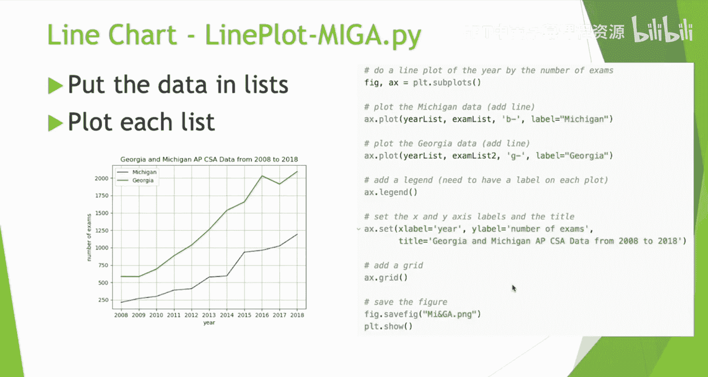
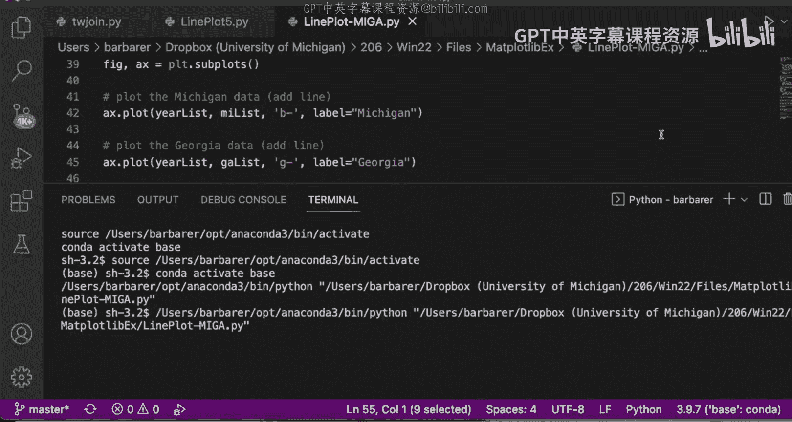

# 创造性编程：60：密歇根与佐治亚数据可视化 📊


在本节课中，我们将学习如何从JSON格式的数据文件中读取信息，并利用Python的matplotlib库，将两个不同地区（密歇根州和佐治亚州）的数据绘制在同一张折线图中进行可视化对比。我们将涵盖数据读取、列表处理、图表创建和美化等核心步骤。


---

## 概述与数据背景

我的一项工作是处理大学先修课程（AP）计算机科学的数据。通常，我会编写程序来分析多个电子表格中的数据，将它们整合到一个表格中，然后进行绘图。

这里有一个包含JSON数据的示例文件。数据记录了每个州、每一年参加AP计算机科学A考试的人数、该州的人口以及考试人数与人口的比例等信息。我们的目标是读取这些JSON数据，将其整理到列表中，并绘制不同州的数据变化趋势。

例如，我曾在佐治亚州工作很长时间，而我最初来自密歇根州，现在又回到了密歇根。因此，我想了解在特定时间段内，AP计算机科学A考试的参考数据在这两个州是如何变化的。

---

## 实现步骤详解

上一节我们介绍了项目的背景和目标，本节中我们来看看具体的实现步骤。整个过程可以分为数据读取、数据处理和图表绘制三个主要部分。

### 1. 导入必要的库

首先，我们需要导入处理JSON文件和绘制图表所需的Python库。

```python
import json
import matplotlib.pyplot as plt
```

### 2. 从JSON文件读取数据

接下来，我们从文件中读取JSON格式的数据，并将其加载到一个Python字典中，以便后续处理。

```python
with open(‘ap_data.json‘, ‘r‘) as file:
    data_dict = json.load(file)
```

### 3. 提取特定州的数据

当数据存储在字典中后，我们需要分别提取密歇根州和佐治亚州的数据。以下是提取数据并将其存入列表的方法。

*   **提取密歇根州数据**：遍历字典中密歇根州的数据项，将每年的考试人数添加到一个列表中。
*   **提取佐治亚州数据**：用同样的方法，遍历字典中佐治亚州的数据项，生成另一个列表。

```python
michigan_exams = []
georgia_exams = []

for year_data in data_dict[‘Michigan‘]:
    michigan_exams.append(year_data[‘num_exams‘])

for year_data in data_dict[‘Georgia‘]:
    georgia_exams.append(year_data[‘num_exams‘])
```



### 4. 创建并配置图表

现在我们已经有了两个列表的数据，可以开始绘制图表了。以下是配置图表的各个步骤。

*   **创建图形和坐标轴**：使用 `plt.subplots()` 初始化画布。
*   **绘制折线图**：用蓝色线条绘制密歇根州的数据，用绿色线条绘制佐治亚州的数据。
*   **添加图例**：为两条线添加图例，标明哪条线代表哪个州。
*   **设置标签和标题**：为X轴（年份）、Y轴（考试人数）设置标签，并为整个图表添加一个标题。
*   **添加网格**：启用网格线，使数据点更容易观察。
*   **保存和显示图表**：将图表保存为PNG格式的图片文件，并在屏幕上显示出来。

```python
fig, ax = plt.subplots()

ax.plot(years, michigan_exams, ‘b-‘, label=‘Michigan‘)
ax.plot(years, georgia_exams, ‘g-‘, label=‘Georgia‘)

ax.legend()
ax.set_xlabel(‘Year‘)
ax.set_ylabel(‘Number of Exams‘)
ax.set_title(‘AP CS A Exam Participation: MI vs GA‘)
ax.grid(True)

plt.savefig(‘mi_ga_comparison.png‘)
plt.show()
```

---

## 运行结果

当我们运行完整的程序后，会生成一个直观的折线图。图表清晰地展示了在选定年份内，密歇根州和佐治亚州AP计算机科学A考试参考人数的变化趋势。通过图例、坐标轴标签和网格线，我们可以轻松地对两者进行比较。

保存的PNG图像文件可以方便地用于提交作业、打印或包含在报告中。



---


## 总结


本节课中我们一起学习了如何完成一个完整的数据可视化项目。我们从JSON文件中读取了结构化的数据，通过遍历字典提取出特定州的信息并存入列表，最后使用matplotlib库创建了一张包含两条折线、图例、标签、标题和网格的对比图表，并将结果保存为图像文件。这个过程展示了数据处理与可视化编程的基本工作流程。