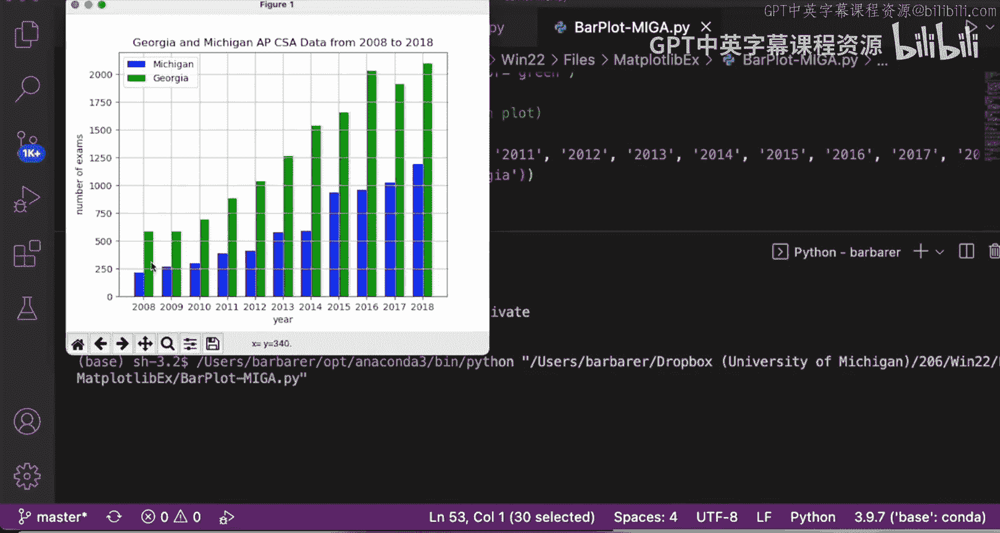

# 创造性编程：194：并列条形图绘制 📊


在本节课中，我们将学习如何使用Python的Matplotlib库绘制并列条形图。并列条形图是一种将多组数据并排展示的图表，便于直观比较不同数据集在同一类别下的数值差异。我们将通过一个具体的例子，展示如何将密歇根州和佐治亚州的AP考试数据并排绘制。


---

## 概述

并列条形图适用于比较两个或多个数据集在同一分类下的数值。例如，比较不同州份每年的AP考试通过率。为了实现这种图表，我们需要对数据进行额外处理，包括计算条形位置和宽度。

## 数据准备

首先，我们需要导入必要的库并加载数据。数据通常以JSON格式存储，我们可以将其读取为字典，然后提取所需州份的数据列表。

```python
import matplotlib.pyplot as plt
import numpy as np
import json

# 假设数据已从JSON文件加载到字典 `data_dict` 中
michigan_data = data_dict['Michigan']  # 密歇根州数据列表
georgia_data = data_dict['Georgia']    # 佐治亚州数据列表
```

## 创建图表与坐标轴

接下来，我们创建图形和坐标轴。这是绘制任何Matplotlib图表的标准步骤。

```python
fig, ax = plt.subplots()
```

## 计算条形位置与宽度

为了并排显示条形，我们需要计算每个条形的位置和宽度。首先，确定数据点的数量（例如，11年），然后设置条形宽度。使用NumPy的`arange`函数生成索引位置。

```python
n = len(michigan_data)  # 数据点数量，例如11
bar_width = 0.35        # 条形宽度
indices = np.arange(n)  # 生成位置索引 [0, 1, 2, ..., n-1]
```

## 绘制并列条形

现在，我们可以绘制并列条形。第一个条形（密歇根州）使用`indices`作为x轴位置。第二个条形（佐治亚州）需要向右移动一个条形宽度的距离，因此使用`indices + bar_width`作为x轴位置。

```python
# 绘制密歇根州数据（蓝色条形）
ax.bar(indices, michigan_data, bar_width, color='blue', label='Michigan')

# 绘制佐治亚州数据（绿色条形），位置向右移动
ax.bar(indices + bar_width, georgia_data, bar_width, color='green', label='Georgia')
```

## 设置坐标轴标签

为了使刻度标签位于两组条形的中间，我们需要调整x轴刻度位置。将刻度设置在`indices + bar_width / 2`处，并设置对应的年份标签。

```python
ax.set_xticks(indices + bar_width / 2)
ax.set_xticklabels(['Year 1', 'Year 2', ..., 'Year 11'])  # 替换为实际年份标签
ax.set_xlabel('Year')
ax.set_ylabel('AP Pass Rate')
ax.legend()
```

## 最终效果

完成上述步骤后，图表将清晰展示密歇根州和佐治亚州每年的AP考试通过率。蓝色条形代表密歇根州，绿色条形代表佐治亚州，两者并排排列，便于比较。


---




## 总结


本节课中，我们一起学习了如何绘制并列条形图。通过计算条形位置和宽度，我们可以将多组数据并排展示，便于比较。关键步骤包括数据准备、位置计算、条形绘制以及坐标轴标签调整。掌握这些技巧后，你可以轻松创建各种并列条形图，有效展示和比较数据。