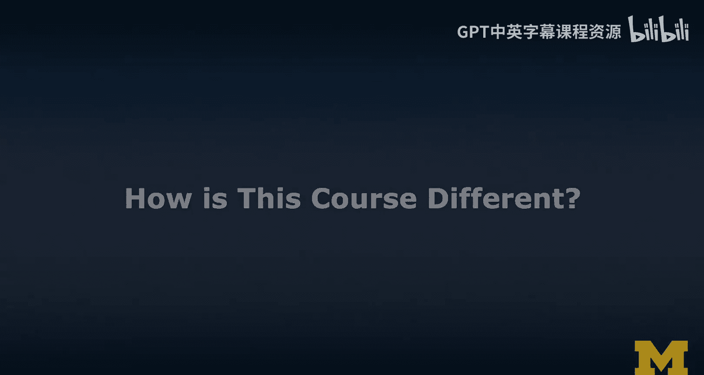
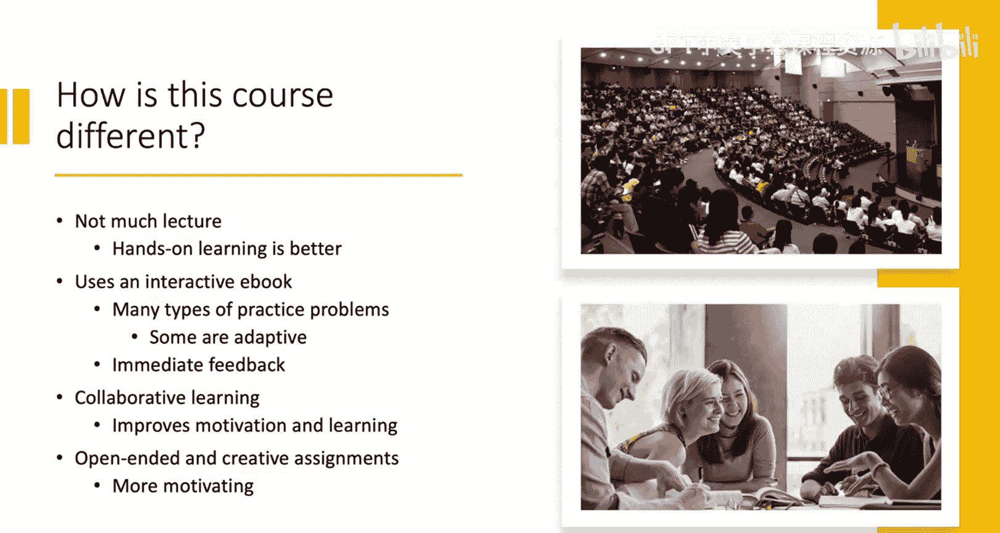
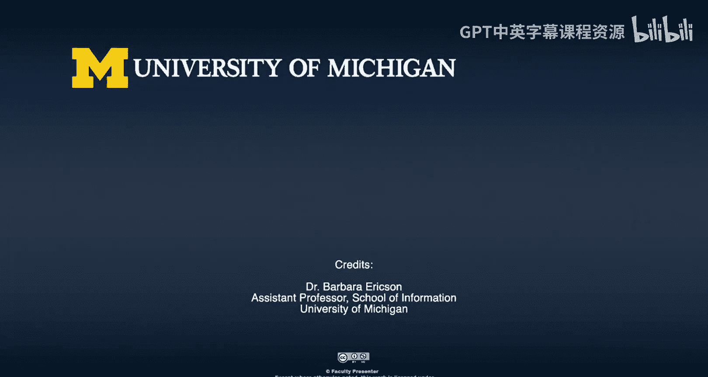

# 密歇根大学《创造性编程（创意、面向对象、debug、QA）｜Creative Coding： Hands-On Python》中英字幕 p02 1_本课程的独特之处.zh_en -BV1ef421S7Bc_p2-

So welcome to this course， it's going to be different than a lot of online courses and it's not going to have a lot of lecture instead it'll be more handson learning。

 we're going to encourage you to work with others to work in groups because that'll improve your learning and your motivation Human are social creatures we can learn from observing others and from discussing with others There's a lot of interactive practice in the ebook and as well as if you need any refresher。

 you can go back to earlier chapters or do more practice problems some of the practice problems are adaptive。

 which means that they'll help you actually get to a correct solution。

And then there's also open edit and creative assignments。

 so rather than often kinds of exercises you get in intro programming courses like calculate sales tax or convert Celsius to Fahrenheit temperature。

 you're going to draw art or create personalized stories。

 so hopefully this will be more interesting and motivating to you。

