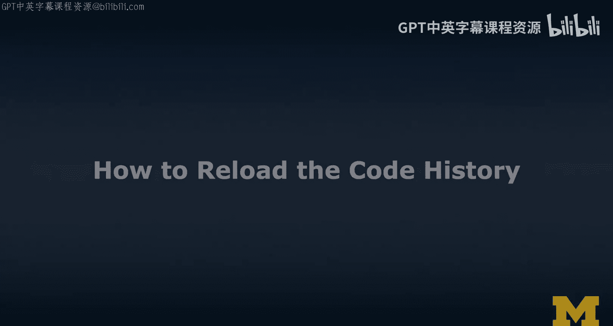
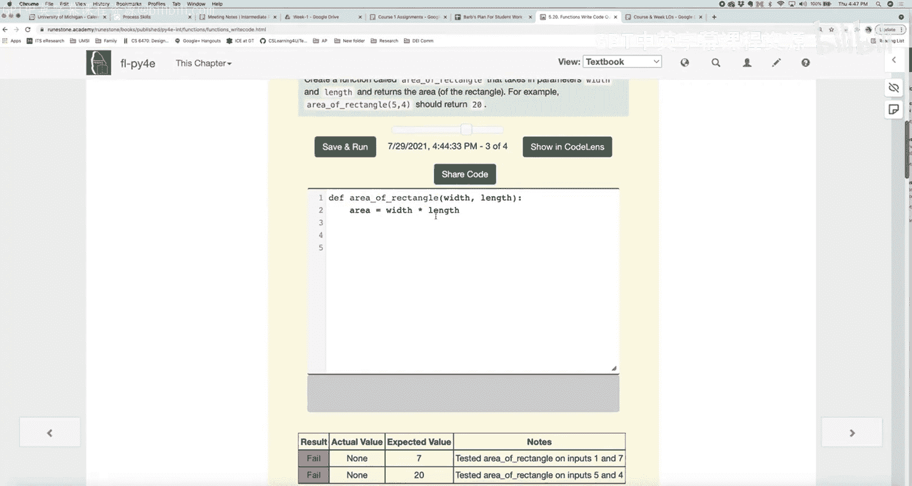

# 密歇根大学《创造性编程（创意、面向对象、debug、QA）｜Creative Coding： Hands-On Python》中英字幕 p07 6_重载代码历史记录.zh_en -BV1ef421S7Bc_p7-

If you've been in the book and you've left it and you've come back。

 you may be shocked to find out that your code isn't saved， but it is saved。

 if you've been logged in， let me show you how you get it back。So if you come back in and you say。

 oh， no， I already solve this problem， notice this load history button。 and be sure to click on that。

 If you were logged in the last time you ran your code， it will load all of your history。

 And now I can see exactly what I wrote the last time that I ran this。

 and I could even go back to previous versions to see what I did then。

So don't panic everything that you do when you're logged in is saved。

 but make sure you click the load history button。

