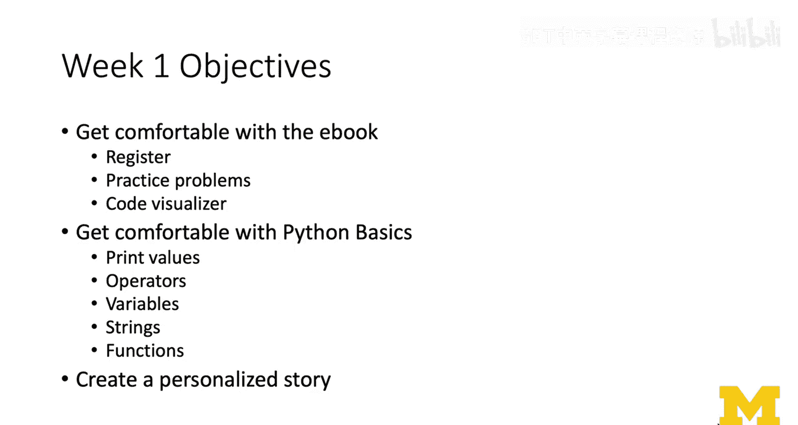
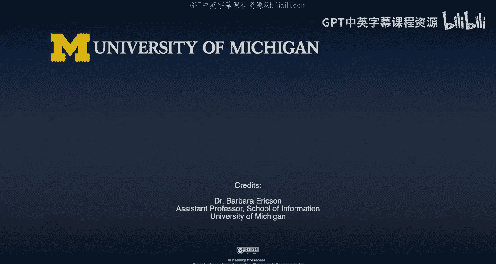

# 密歇根大学《创造性编程（创意、面向对象、debug、QA）｜Creative Coding： Hands-On Python》中英字幕 p08 7_欢迎进入第一周.zh_en -BV1ef421S7Bc_p8-

Welcome to week1， everybody。 What are you going to learn this week。

 So this week we're going to get you comfortable with the ebook。

 you're going to register for the book so that when you write code that it's saved so it has your youll log into the book。

 It'll save what you've been working on。 It'll save your answers。

 You're going to get used to the different kinds of practice problems in the book。

 There's lots of different things you can do in the book， fill the blank， drag and drop。

 mix up code problems， youll also get familiar with the code visualizer where you can step through code and see exactly what's happening。

And then we're going to get you comfortable with basics of Python。

 so that means you're going to learn how to print values。

 you're going to run the mathematical operators， how to create variables。

 how to create strings or sequences of characters， how to get substrs or slices out of a string。

How to create your own functions and how to use common functions that are already in Python。

 You're going to use all this to create a personalized story。 Hope you have a great time。

 Don't be Don't be afraid to make mistakes。 That's how you learn。😊。

