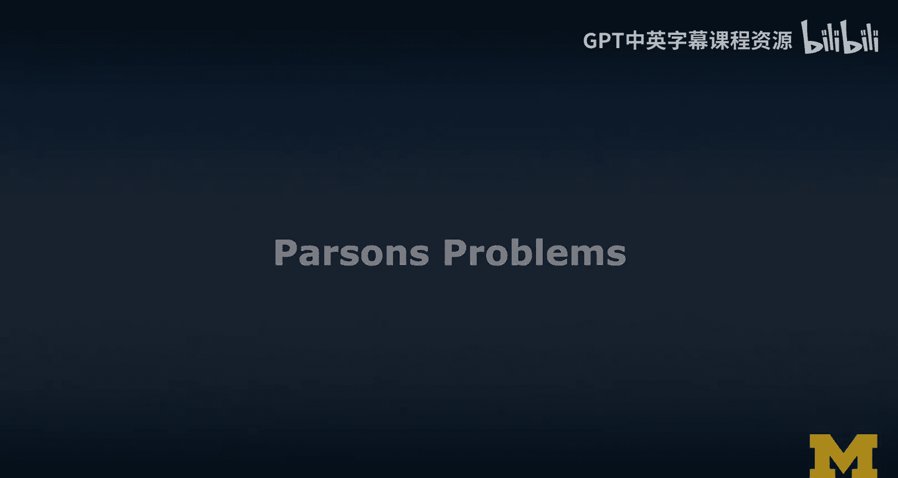
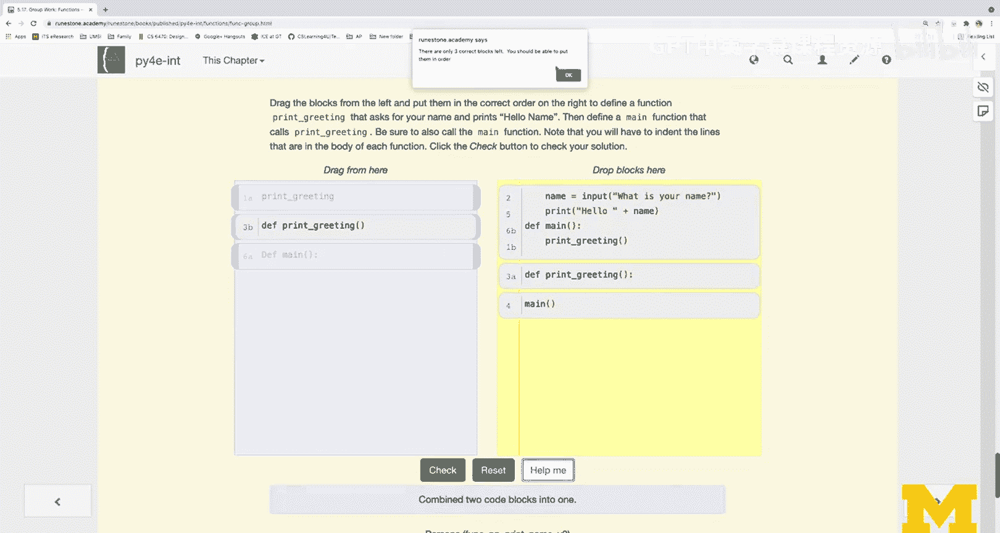
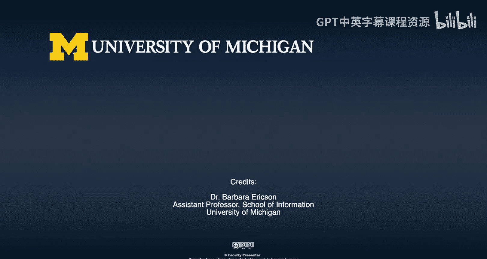

# 密歇根大学《创造性编程（创意、面向对象、debug、QA）｜Creative Coding： Hands-On Python》中英字幕 p09 8_混合代码帕森斯问题.zh_en -BV1ef421S7Bc_p9-

One of the things I've been working on to make programming easier。

 something called Parsons problems or mixed up code problems。 Basically。

 we give you all the correct code to solve a problem。 We break the code into blocks and mix it up。

 So then what you have to do is drag the blocks into the right order from the left side to the right side to create your own solution。

 If you're having trouble。 one of the ways I've also make this easier is there's a helpme button at the bottom。

 If you submit at least three incorrect solutions。 you can click the helpme button。

 and it'll get rid of a distractors。 So there's code blocks not needed in a correct solution。

 So those will go back to the left and gray out。 or it will combine two blocks into one。

 It'll keep helping you until you get down to three blocks。

 and then it'll tell you you should be able to do this on your own。 So let's take a look。

 This is a parson's problem。 you can see the mixed up code on the left。

 There's also pairs you can see here of correct and incorrect code。

 So one of these1 A or1 B is correct and one's incorrect。

 But I'm just going grab a bunch of these and put them over here。

 remembering to grab just one of the pair。When there's two here with the aura on the left side。

Now that I have a complete solution。 I can check that solution， clicking the check button。

 It'll highlight things that are wrong or in the rot order。

 So I may try to move them and check again。 still not right， move check again。

 But I've done at least three incorrect solutions。 It tells me that I can use the help me button to make the problem easier。

 So I click the help me button。 First thing it's going do is get rid of an incorrect code block。

 So I see that animating going back to the left。 It even pairs with the correct， which is a hint。

 Hey， use this one。 I can grab that one instead。 Then there's still。

 if there's still any other incorrect code blocks， it will also remove those。

 So it'll keep doing that each time I click the help me button until I get rid of all the incorrect code blocks。

 Now it's going to combine two blocks。So one block moves up and then it't get redrawn as another。

 and I can keep asking for help until we get down to three blocks。

 So it'll keep combining blocks Every time I ask for help until I get down to three blocks。

 Then it'll tell me， hey， you should be able to put those in order。

So remember to use the Help me button when you're stuck when you're trying to solve these mixed up code problems。

