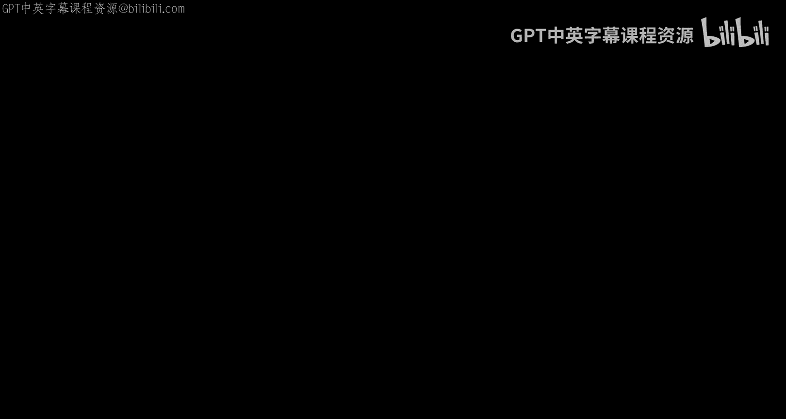
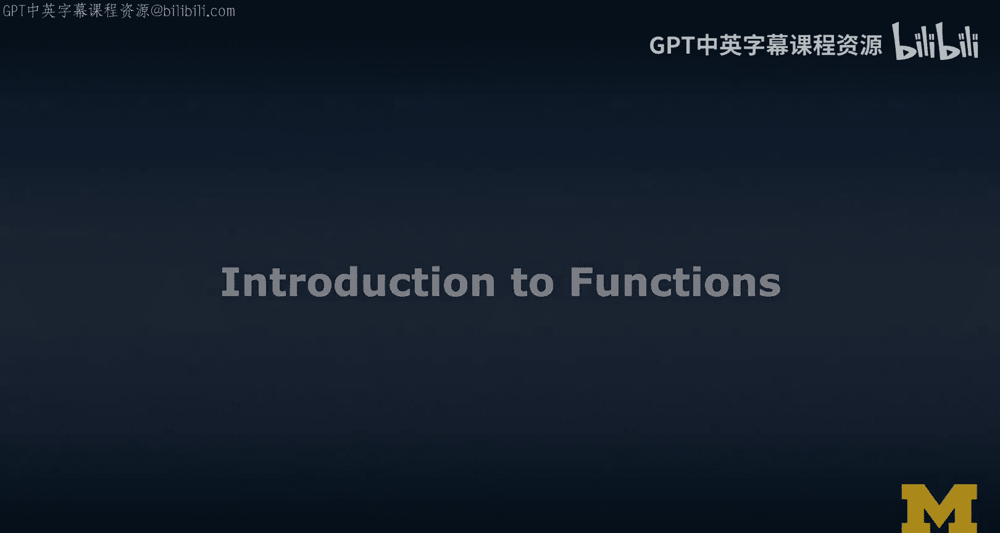
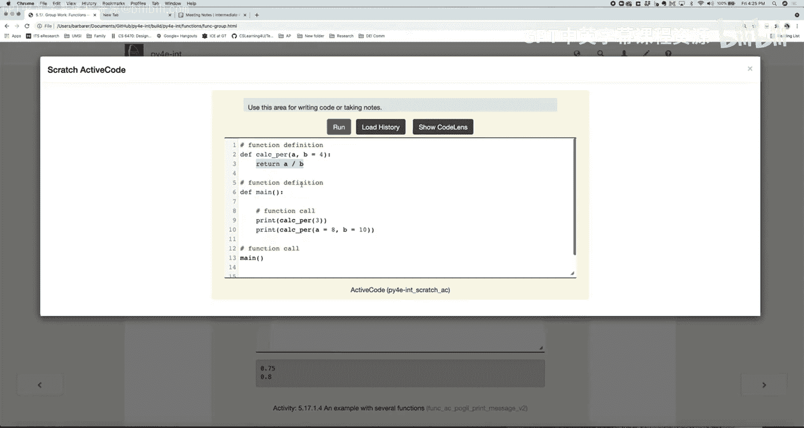
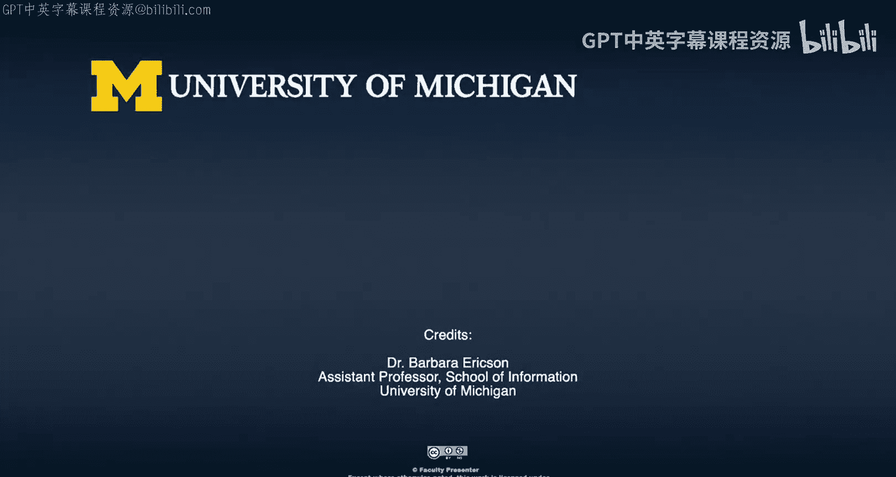
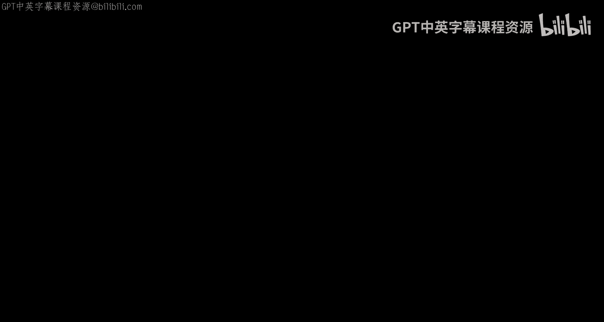

# 密歇根大学《创造性编程（创意、面向对象、debug、QA）｜Creative Coding： Hands-On Python》中英字幕 p10 9_函数入门指南.zh_en -BV1ef421S7Bc_p10-

So functions name a set of statements in Python， and then when you invoke that function。

 those statements will be executed。 let's take a look at this example。

So we have two function definitions。 So everything that's part of this。

 Everything that's highlighted is part of the function definition。

 So there's one for Calc underscore per。 There's one for main。

 The header is just this first line that ends in the colon。 That's the header。 The name is the。

Whats following the de， the keyword de says this is a function definition。

 and before the parameter list。 This is a list of names for values that will be passed into the function。

 I notice you can specify a default value here。 You can also， when you call a function。

 These are both function calls。 So we use the name of the function。

 cc per followed by a parameter list。 In this case， we call it with just  three。

 So B will' have a default value of 4。 Whereas here。

 we're naming each of the parameters that were each of the arguments that we're passing in。

 So we're saying， hey， set a equal to 8 and B equal to 10。

 Since one of the things you can do in Python。 This is the actual also actually a function call。

 right calling this main method。 Notice that functions don't have to take any parameters。

 and you can return a value from a function using the return keyword。

 You don't have to return anything。 the main method doesn't return anything。

And so that's a quick introduction to functions。

