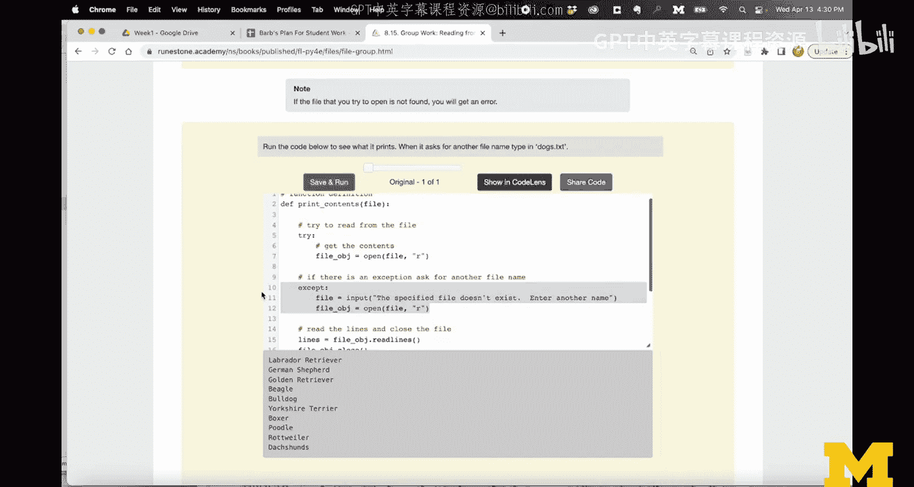

# 密歇根大学《创造性编程（创意、面向对象、debug、QA）｜Creative Coding： Hands-On Python》中英字幕 p100 12_try-except异常处理.zh_en -BV1ef421S7Bc_p100-

So what happens if you're trying to read from a file and the file doesn't exist So if we run this code。

 we're trying to read from unknown。 TxT。And whatll happen is we'll get an error。

 No such file or directory。 So that could either mean that we've spelled the file name wrong or we're looking in the wrong directory。

 and it just crashes your program。 So we'd like to handle that a little bit better。

 a little bit more gracefully。 And a way to use do that is to use a try and accept。

 So we put in the try anything the body of the try， anything that could cause an exception。

 So we'll try to open the file for reading here。 And then the exception is what do you want to do if an error occurs。

 So if an error occurs， we're going to tell you，'re we're going have an input message that the specified file doesn't exist。

 enter another name。 We're going to get another name from the user and then we're going try to open that file。

 and then we'll continue。 So if I run that code， it says the specified file doesn't exist enter another name and we'll try togs T X T and that'll execute。

 So use a try inclose in a try， anything that can cause an exception or an error。

 and then in the accept part。That specify what you want to happen。

