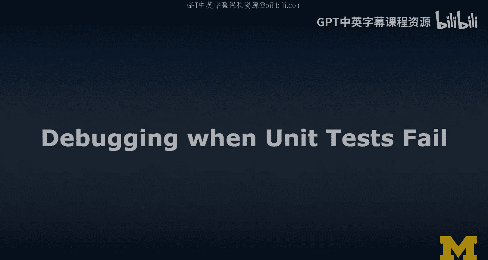
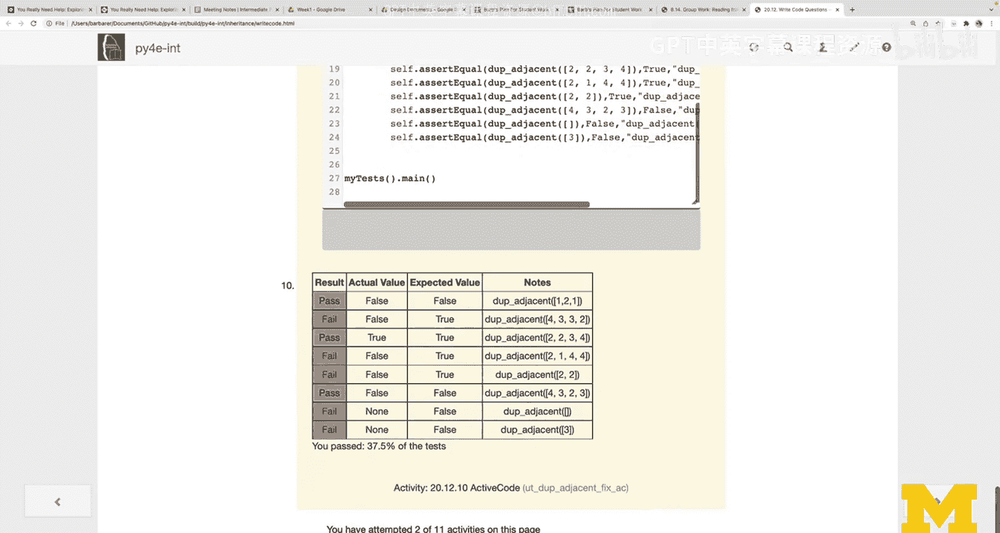
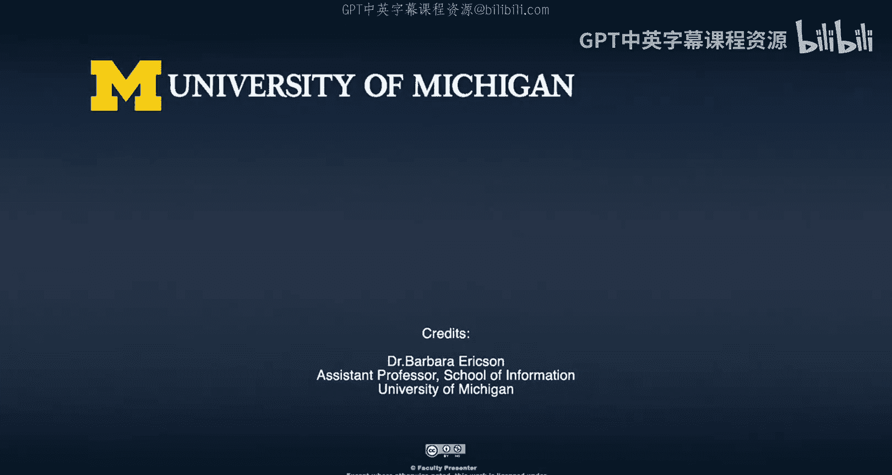

# 密歇根大学《创造性编程（创意、面向对象、debug、QA）｜Creative Coding： Hands-On Python》中英字幕 p101 13_单元测试失败调试.zh_en -BV1ef421S7Bc_p101-

So how do we debug if one of the test cases fails， So here's some code that we need to fix。

 If we run it， we see that it's failing。 Most of the test cases。

 And we may not understand why if you look at the notes， this tells us what we're actually testing。

 So duplicate adjacents of one comma2 comma 1， there's no numbers that are duplicate that are adjacent to each other。

 And it's expecting the value of false that makes sense。 but we're getting a value of true。

 that seems odd。 If I try to show this just directly in the code lens。It'll run， but。

When I try to run it， I'm going to get an error because it doesn't know the unit test that GuUI that we're using。

So， but never fear you can instead go up here and get rid of the in test for the moment。

 but let's copy out just that piece to see what's happening。

 so let's see what's happening when that's not working correctly。So I can call just that。

Remember that a method in Python won't run unless you actually call it。

 so we've been calling it in our unit test， but here we'll have to call it explicitly。

So now if I show this encode lens。I see just this。 and if I say next。

 so let's see what's happening when we do that。 So it comes in， it says is length equal to2 no。

 for I and range length of nus， cur equals nus of I。 So I is0， so nus of I is1。

 and then previous is nus of I minus1。And that's going to be from0。

 minus-1 is going to be negative one and what it's doing that is getting the last object in the list because remember negative one and Python means the last item。

 So instead of comparing two that are adjacent， we're comparing the first and the last and they happen to be the same value。

And so this is going to return true when it shouldn't， aha。So that's one problem。

 we can certainly fix that。So we could go back to hide this code lens， go back and change this code。

 we can refresh to bring this all back in to get all our test cases back。And we can fix this to say。

What we really want to do is check the adjacent。 So if we're going to look at something and the previous。

 we don't want to start at 0。 We want to start at one。

 so we can use the range feature where you can specify the start and the end。

And then if we do that and run it， we see that we've improved， there's still some errors。

 I'll let you try and see if you can figure out the rest。

