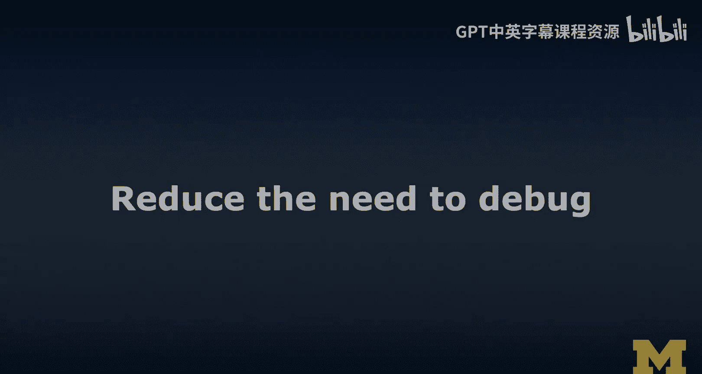
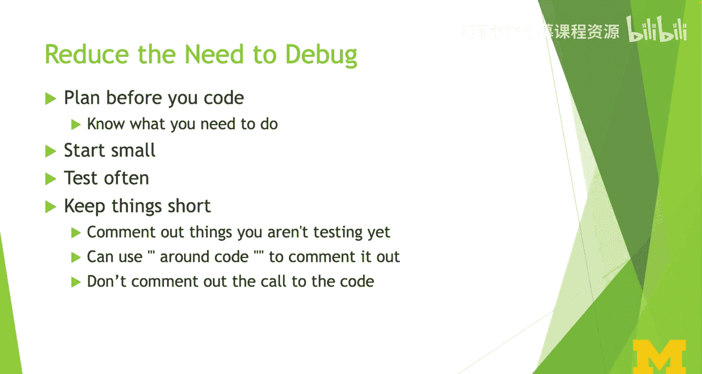
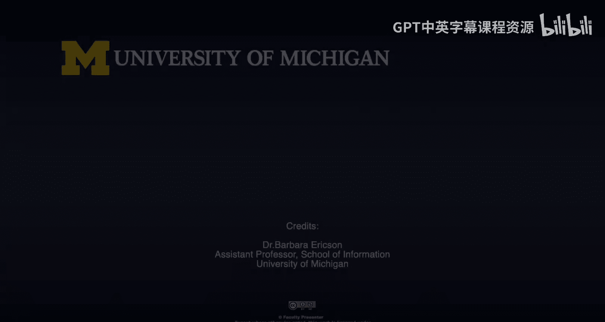
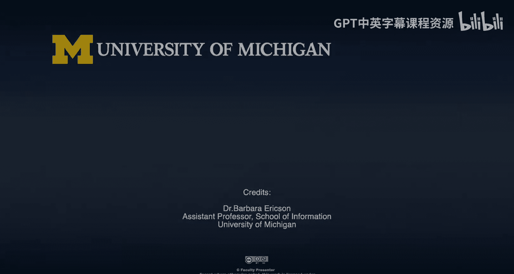

# 密歇根大学《创造性编程（创意、面向对象、debug、QA）｜Creative Coding： Hands-On Python》中英字幕 p102 14_减少调试需求的方法.zh_en -BV1ef421S7Bc_p102-

So one of the best things to do is to avoid the need to debug by trying to reduce how many bugs you actually have in your code。

 How do you do that？ Well， what you want to make sure you understand is what are you supposed to be doing。

 What is the input you're supposed to have， What is the output， How is the code supposed to work。

 Write at least at English like level algorithm for what are you trying to do。

 So plan before you code， what is for certain input， What should the output be。

 This is often called test first development or you first write the test cases。

 Because how you know if your code works， if you don't know what it's supposed to have as input and output。

Start small， write a couple lines of code and then test those。

 make sure that you're testing early and often。 So start small add a little bit。 test it。

 keep adding a little more test it That way， you know that that piece is already working and then keep things short。

 So if you have things that you're not testing yet， you can comment those out。

 you can use the triple quote makes a multiline string around code that you want to comment out for a while。

 just make sure you un it。Before and make sure you don't comment out any call to the code because code won't execute if you don't actually call it。

 so try to avoid debugging if you can。

