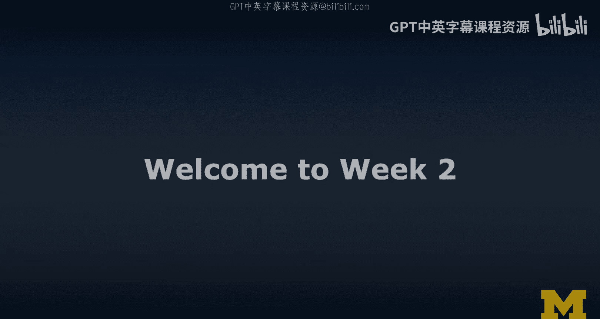
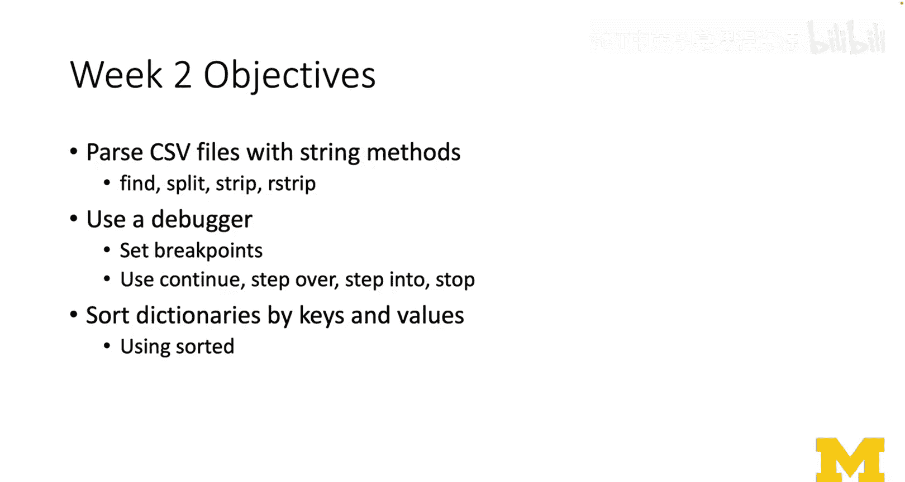
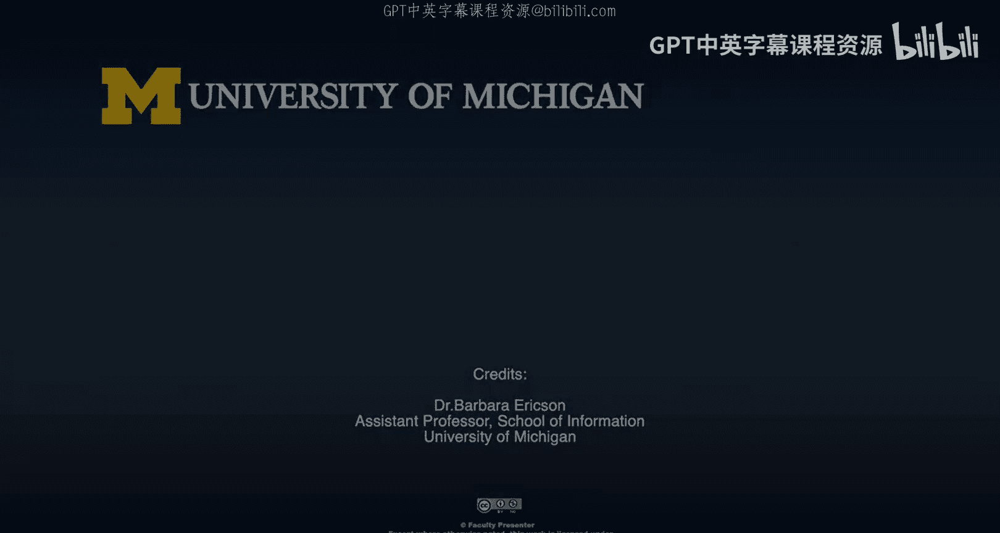

# 密歇根大学《创造性编程（创意、面向对象、debug、QA）｜Creative Coding： Hands-On Python》中英字幕 p103 15_欢迎进入第二周.zh_en -BV1ef421S7Bc_p103-

So what are you going to learn this week this week we're going to work with comma separated value or CSV files that's a standard way to exchange data。

 which you're going to learn is how to parse those files with string methods so using fine split。

 strip， Rstr， how to use it tobugger， how to set break points and loop through your code with a continue or step into step over or stop。

You're also going to work on sorting dictionaries by keys and values using the sorted function。

