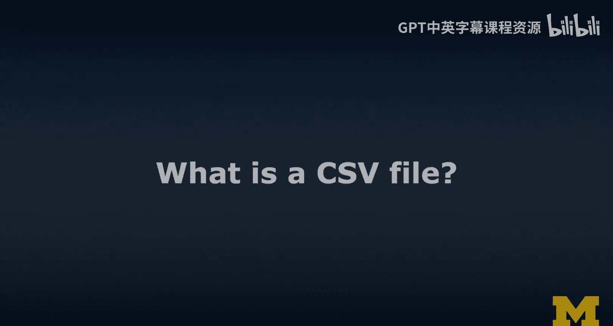
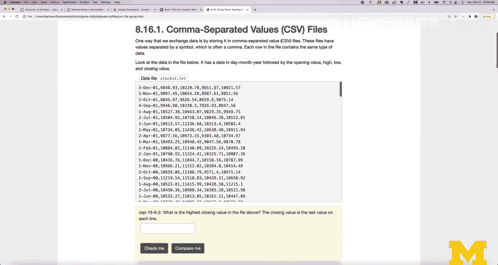

# 密歇根大学《创造性编程（创意、面向对象、debug、QA）｜Creative Coding： Hands-On Python》中英字幕 p104 16_CSV文件解析.zh_en -BV1ef421S7Bc_p104-

So what is a CSV file， Well， it stands for comma separated value and it's a list of values in a file。

 and each row typically has value separated by a symbol， typically a comma。

 but doesn't have to be a comma。 So here's an example。 this file。

 stock do TxT has a date as a day dash month dash year where the month is just three letters。

 and then follow by a comma and then it's the opening value for that day。

 the high value for that day to low value for that day and then the closing value for that day。

 And so we can read this data， and we can process it in order to answer questions。

