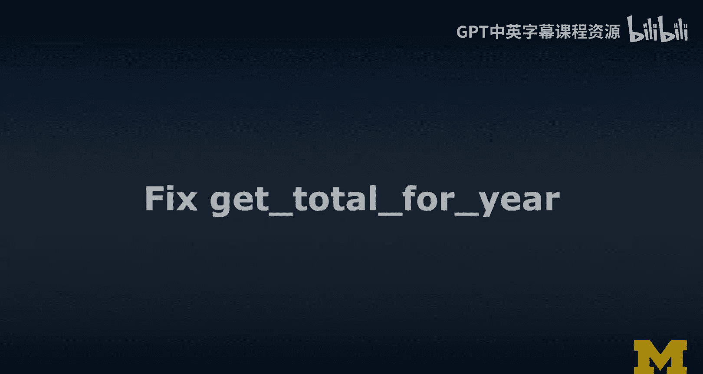
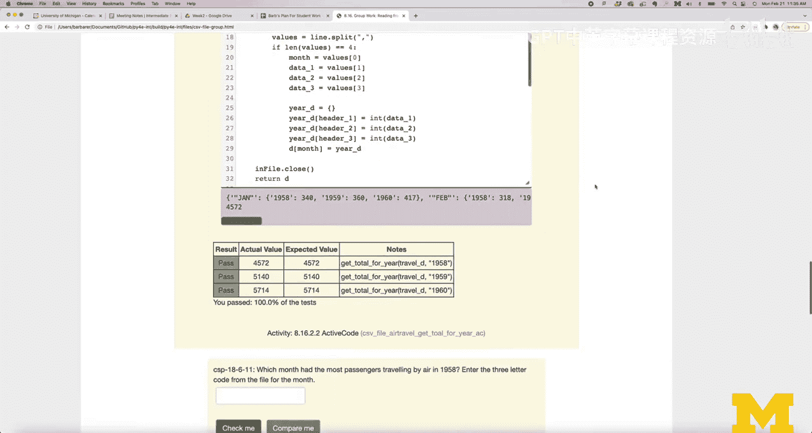

# 密歇根大学《创造性编程（创意、面向对象、debug、QA）｜Creative Coding： Hands-On Python》中英字幕 p105 17_修复get_total_for_year.zh_en -BV1ef421S7Bc_p105-

So hopefully you enjoyed doing that practice。 Let's go over how do you could debug one of these assignments。

 So here we're supposed to look at this data above。

 So we have monthly air travel for different years，58，59，60 and for different months。

 So we're processing that data。 and we're trying to figure out the total for 1958 is one of the things that we're trying to get here。

 So we see， trying to look for the total for fit 1958。

 So if I save and run this code to see what current errors we have。

We see we're getting a key on line 38 and line 38 is where we are adding the total for the particular year。

 So why are we getting a key， It should have these keys。

 But if you look at the data here that we've printed out。

 we see that when we've read the string and the string already has double quotes around it。

 we're getting the double quotes， plus we're getting extra spacing。

 So we need to get rid of some of that。So here， when we read in the headers is where we're just putting those values directly in header1。

 header 2 header 3。 But first we want to get rid of some of that。 So we're going to split。

We're going to strip， sorry， not， split strip。Those values off and we want to get rid of the double quote。

And the space。 And so we can just add that to each of these。

To get rid of those values on either side member strip will get rid of them at the front and the back。

So if I do that and run that。I'm still getting an error now in line 38 that we can't add integer and string。

 Remember when you read in data。It comes in as a string。

 So when I'm trying to add data and it's a string， which I can see here。

 it's still a string rather than a number。 So I need to convert that to a number。

 but it also has some extra spacing on it。 So we can try just to convert to integery if that handles the spacing。

 Okay， so let's check that if I change it to integer。For each of these values。

Does that get rid of that problem？Al right， so now it's working for everything but 1960。

 So what's with 1960。 So here's 1958， And we have a number now，1959， we have a number。 at 1960。

 we forgot to get rid of the new line。 So that's not going to match。 Plus。

 it's still got a double quote in it。 Why does it still have a double quote。

Should have gotten rid of it。 because the new line is there as well。

 So let's try to get rid of that as well。And are we having error with a number。

 We're not having an error with a number so that should be okay。So if I now run that。Now it works。

 so that's one way you can debug this code and make sure that you pay attention to converting things to strings and stripping off anything that you don't want。

