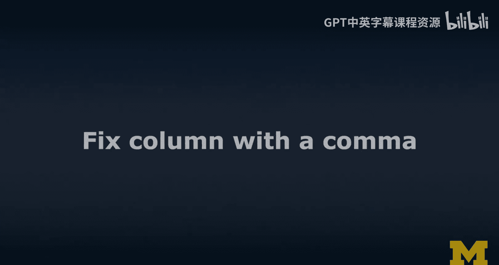
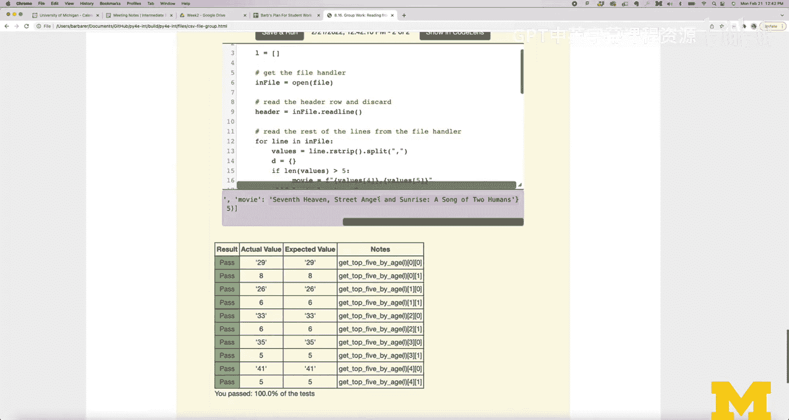

# 密歇根大学《创造性编程（创意、面向对象、debug、QA）｜Creative Coding： Hands-On Python》中英字幕 p106 18_修复含逗号的列数据.zh_en -BV1ef421S7Bc_p106-

So we've been processing CSV files by splitting on the commas。

 But what happens if one of the columns contains commas or one or more， Here's an example of this。

 We have data about Oscar。For best actress。 and we have the year， how old the person was。

 what was their name， What was the movie title。 And notice the movie title here has a comma in it。

So one of the things you can do when you're working with CSV files is sort of check to see that the right number of columns。

 and if there's more columns than you expect， you might want to print out that line to see what's happening。

So here I've printed out this line， I can see I， yes。

 there's a comma in the movie in the movie title and right now we're just exiting so instead if we want to actually handle that。

Well， so we split that comma。 so it broke the movie title into two pieces。

 and we want to put it back together。 So for movie。Which down here。

 we're saying is equal to values of 4。 We're going to say is equal to。

 and I'm going to put it back together with an F string。 So I'm going to say， use the values of4。

Followed by a comma and then， but also add values of five。And then here， I want to。Otherwise， if。

Length is equal to five set movie V to that。 And then I'm going to say if length of values is greater than or equal to5。

 then do the rest of this stuff。So we still want to do the rest of it。

So that has solved it that first movie we do see the movie title now being complete with the comma。

 everything looks okay。

So that's one way to solve it， but what would happen if there are multiple comms in multiple columns。

 there's got to be a better way。

