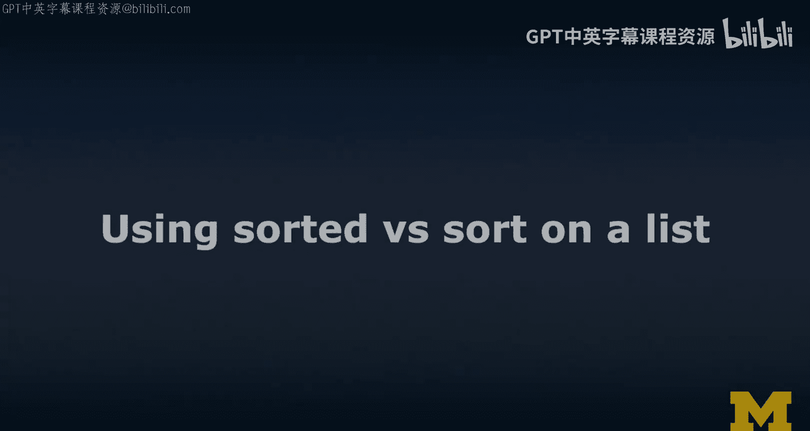
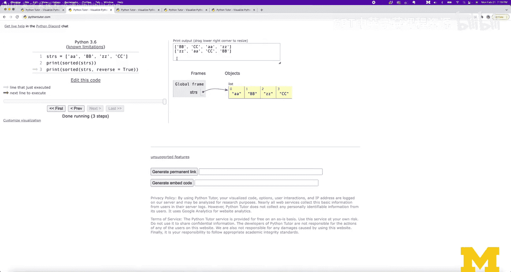
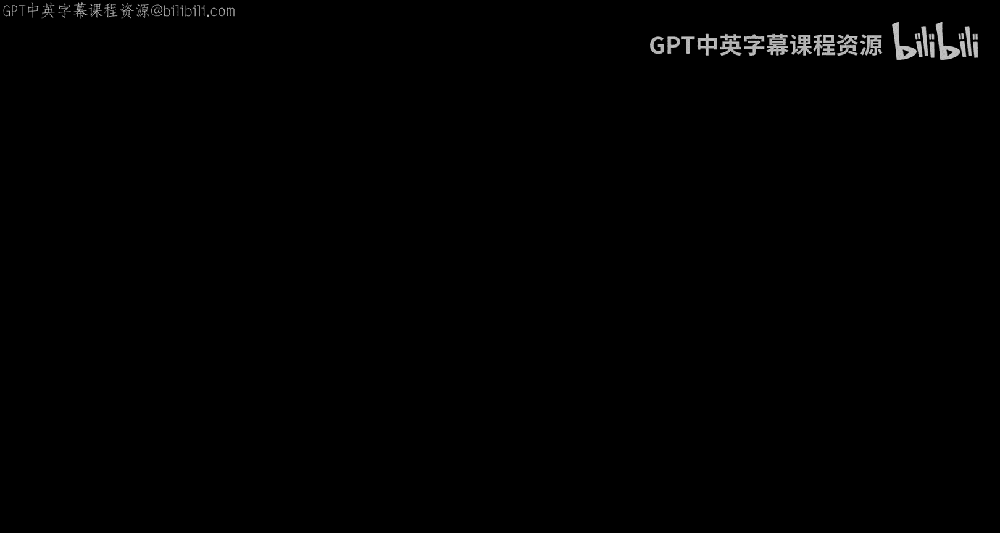
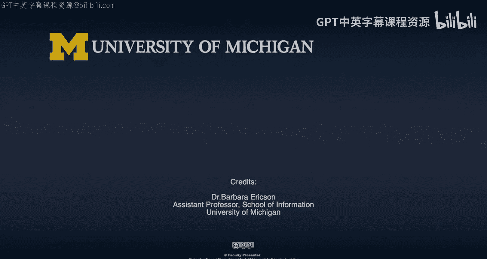

# 密歇根大学《创造性编程（创意、面向对象、debug、QA）｜Creative Coding： Hands-On Python》中英字幕 p107 19_sorted与sort方法对比.zh_en -BV1ef421S7Bc_p107-

So you may recall that there's a way to sort a list using the list dot sort method。

 but there's also a sorted functions。 Let's look at that。

 So you can say sorted on any iterable collection。 So this could be a list， a string， a tuple。

 and it returns a sorted list in a sendingending order。 But it doesn't change the original。

 So if we look at this example code， here's a list A that has51 come4 come a 3。

 If I print sorted of a， I see it sorted in a sending order。 That's the default。 But if I print a。

 I see that a hasn't changed。 whereasas if I print a dot sort， it doesn't return anything。

 So that's going to be none。 But if I then print a， it will have sorted in acending order。

 So let's take a look at that。Here in the Python tutor。 So if I go all the way to the beginning here。

 I see creation of a and I have my elements in my list。 If I print sort of a。

 I see the ascending order。 If I print a now， I see that a has not changed its order。

 If I print a dot sort， I'll see none。 But I also see that a has now changed its order。

 It's now in a ascending order。 And then if I print A， I'll see that it is an ascending order。

You can also sort in descending order by simply adding the keyword it reverse equal true。

 so this is an optional parameter that I can specify by saying reverse equal true。

So I have potentially if I had a list of strings with lowercase A's， then B， capital B's。

 then lowercase Z's and capital C's。 and I said sortded of strings。

 remember it's not going to change it。 is's just going to return a new value。

 It would print it this way。 I notice with strings。

 capital letters are less than the upper case sorry the capital letters are less than the lowercase letters。

 And whereas if I reverse this， I see the lowercase letters are larger values than the uppercase letters。

And we can see that as well in Python tutor。 So here we are in Python tutor with the same code。

 if I start at the very beginning， I see there's my list of strings。 If I print sort of strings。

 I see it's now print in ascending order， though it hasn't changed the strings list。

 and if I print sorted of strings and reverse order in descendending order， I see that but again。

 it doesn't change the strings list。

