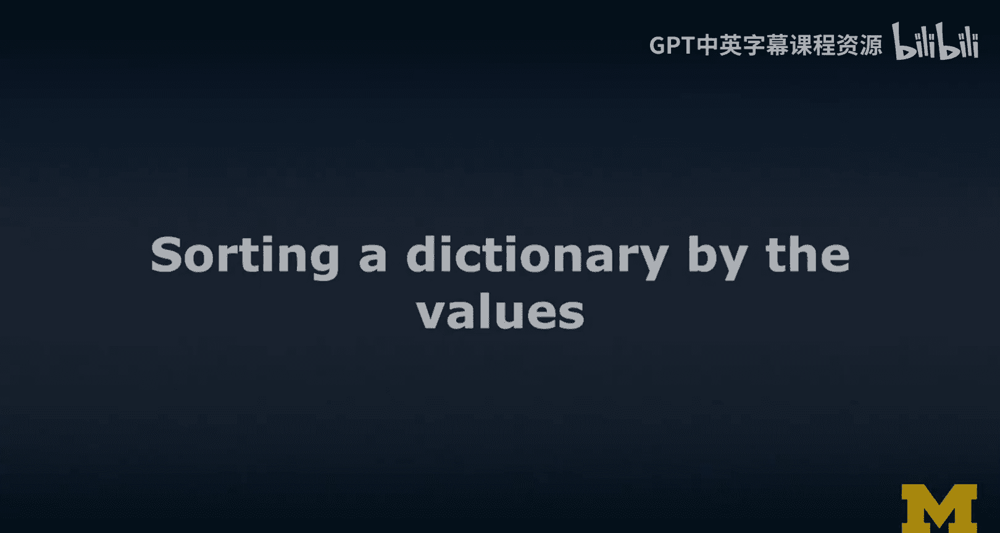
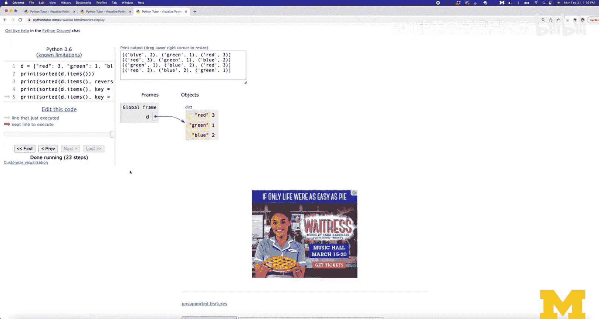

# 密歇根大学《创造性编程（创意、面向对象、debug、QA）｜Creative Coding： Hands-On Python》中英字幕 p108 20_按值排序字典技巧.zh_en -BV1ef421S7Bc_p108-

So how could you sort a dictionary so you can try sort it on a dictionary， let's see what happens。

So if you have a dictionary here with colors like red， with the value 3， green of the value of one。

 blue with value of2， and you print sorted of the dictionary。

 What you get is a sorted list of the keys in ascending order。

 or if you say sorted of the dictionary with reverse equalQL true。

 you get the keys in descending order。 and you can see that in Python tutor here。

 So here I've created my dictionary。 if I say print the sorted value of it。

 I get the sorted keys in a sendingending order。 And if I print the sorted with reverse SqQl truee。

 I get them in descending order。 Probably not what I was really after。

 what I would rather do is probably see both the keys and the values。 So how could I do that。Well。

 you can get the keys and the values if you get items first from the dictionary。

 So you get that sorted list of tuples， you get a list of tuples and you can sort that list of templeples。

 Well what is it sorted on again。 So if I say dictionary equals this dictionary and I say print the sorted。

Sored on D dot items， which gives me a list of tuples。 What I get is the list of tuples again。

 sorted by the key in ascending order。 Or if I say print sorted of D dot items with reverse equal true。

 I get the list of tuples sorted now by keys in descending order。 Again。

 probably not what I was really after。If I really want to sort on the values instead。

 I have to use something interesting， I have to use this temporary function called Lambda。

So if I say here's my dictionary and I say print sortative of D's， I see that that prints the。

List of Tuples， but sorted by the keys in ascending。

 if I say print sorted of D with reverse equal true， I see I get the sorted list of Tuples。

 but sorted again on the keys descending。The I say print sorted of Ddot items。

 And then I say the key equals lambda。 So key equals lambda saying。

 let's use this temporary function。 and the temporary function is going to take a tuple。

 And what it's going to return is the value at index 1 of the tuple。

 So I'm going to sort based on that。 And so thatll let me sort on the values because that's at index1。

 the key is in an X0 and the values at index 1。 So let's say basically sort on the values rather than the keys。

 And here I see now I've sorted on the values in ascending order。

 I still see the keys and value pairs， but it's sorted by the values。

And if I want it in descending order， I can do the same thing and just add reverse equal true。

 and I see I get the sorted on。The values in descending。

 so I can see that happening over in Python Tutor。I see my dictionary。 If I print sorted。

 I see I'm as sorting by the keys。 I have my list of tables， but sorted by the keys in ascending。

 If I use reverse equal truth， sorted by the keys and descending。

 if I say sort using this temporary function to sort by the values， the things at index1。

 I'd now get a sort based on。W。Why is that not going next， Oh， it's showing me that the temporary。

The Lada function， so it took me a little longer to loop through it。

So it created a temporary function， it used the temporary function to do the sorting。

 and now I see Ive sorted by the values in ascending order。

 and again now I've created a temporary function， this little lambda symbol is the symbol for a lambda。

 So it's a little function that just gets created on the fly。

 It takes a tuple and it's going to return the value at。The index one， which is the tuple。

 which is the value。So I'm going to see each of those return values show up and it's going to sort it in descending order so you can sort a dictionary。

Using sorted， but you have to first get the items of it。

 which is the list of tuples and then you can sort that list of tuples by the values if you create this lambmbda function。

 this temporary function。

