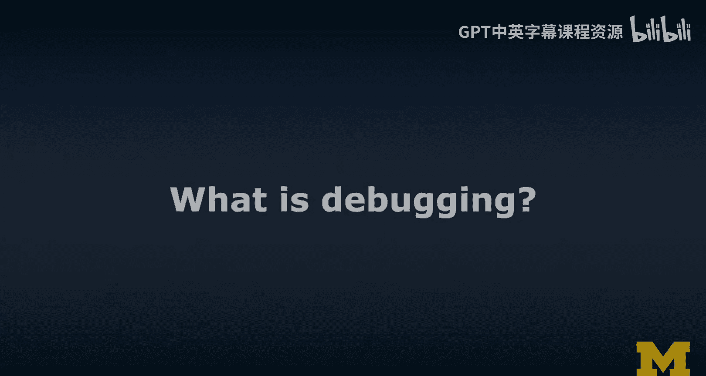
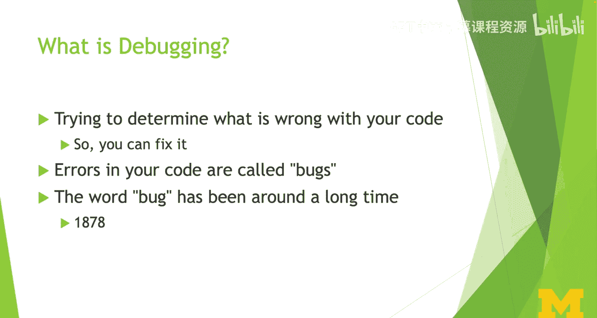

# 密歇根大学《创造性编程（创意、面向对象、debug、QA）｜Creative Coding： Hands-On Python》中英字幕 p109 21_调试技术解析.zh_en -BV1ef421S7Bc_p109-

So what do we mean by debugging， Well， debugging is trying to figure out what's wrong with your code If it has a bug and it's not working。

 this may mean it doesn't compile。 It may means that it runs。

 but doesn't do what you expected it to do。And errors that you find in your code are often called bugs。

 And that terminology has been around for a long time。 It exists at least since 1878。 Occasionally。

 people will misattribute bug to Grace Happer finding an actual bug in a computer in the 1940s。

 And that story is not correct。 with the word term bug had been around well before that。 And in fact。

 they taped the bug to the log to show that this was the first case of an actual bug being found though it was causing a problem because the bug had gotten stuck in the computer and caused an issue with it。

Typically it's not a real bug that we're looking for。

 but we're looking for some sort of error in our code and we're trying to fix it。

