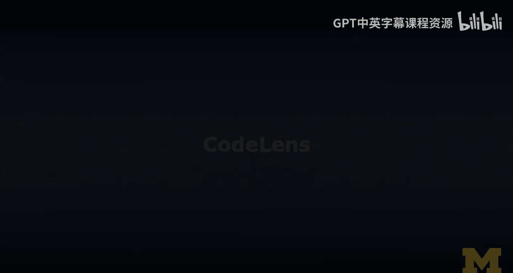
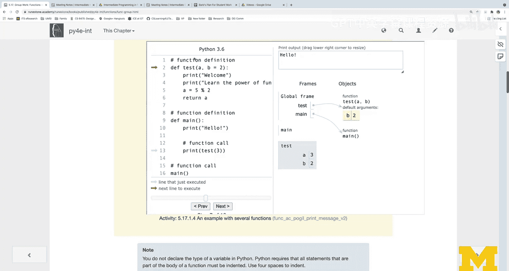
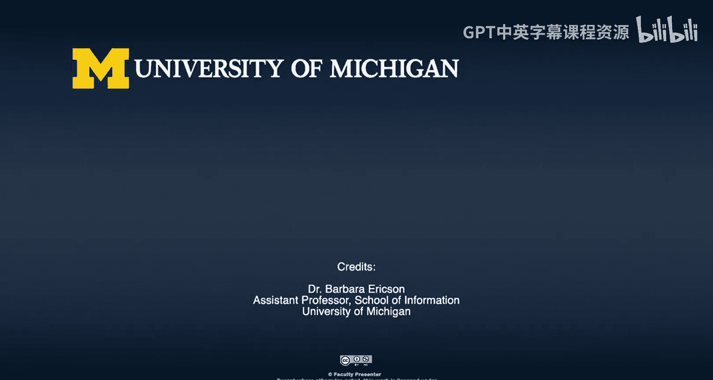

# 密歇根大学《创造性编程（创意、面向对象、debug、QA）｜Creative Coding： Hands-On Python》中英字幕 p11 10_CodeLens代码可视化.zh_en -BV1ef421S7Bc_p11-

One of the other useful things for figuring out what's happening with your code is to run the code lens。

 and you'll notice that a lot of the active code in the ebook will have this code lens button。

 So what is that。 Well， when you open up the code lens。

 your're opening a version of the Python tutor， which lets you step through your code and visualize or see exactly what's happening as your code executes。

 also shows you the value of each variable。 So let's take a look。 Here's a simple function test。

 which also is followed by another function main， and then there is the call actually to main。

 So when I click this in the show code lens button。 I see it show up below the code here。

 The red line says this is what we're about to execute。 Notice that it skips the comment。

 The computer doesn't care about comment。 So it says the first thing I'm going execute is line to。

 I'm going to define this function test。 When I click the next button。

 goes ahead and defines the function test， and then skips to the next definition。

 When I click the next button， it'll go ahead and define the function main， And now it's ready to。😊。

Exec the function main with this call in line 16。 So when I click that next button we go back to the function main now and actually execute it。

 We execute the header and then we're going to go ahead and print hello。

 so we notice that hello gets printed here Now we're going to print the results of calling test3 so that means we're going to move to function the test and we're passing in it。

 the value 3 for a so notice that a is3， but B is has a value also too because we've set a default here in this function definition for B。

 the default is2 if it's not specified。

So this is a quick intro to code lines， go ahead and use it to understand what's happening in your code。

