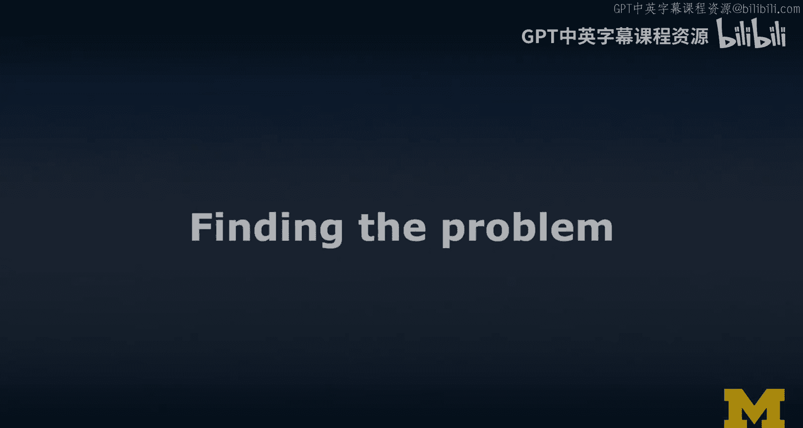
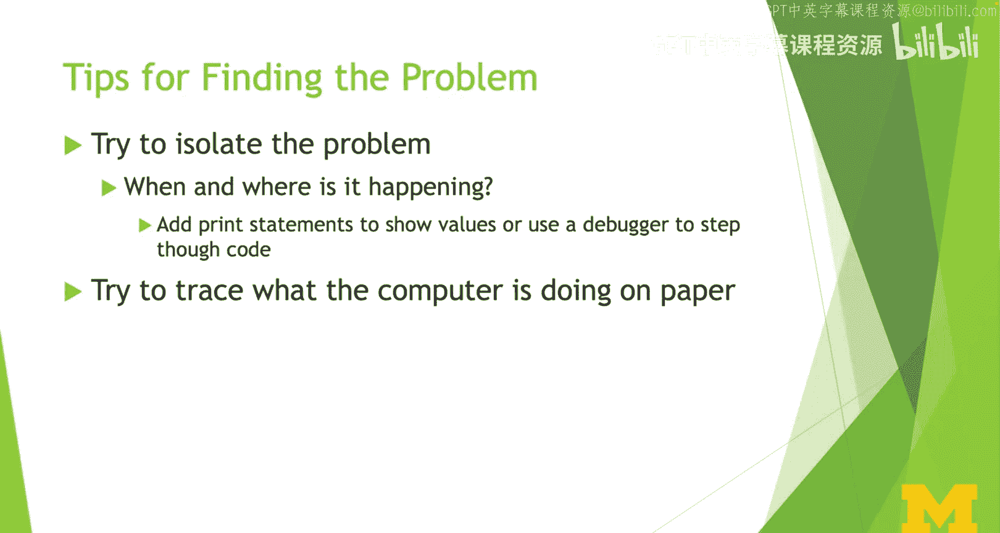

# 密歇根大学《创造性编程（创意、面向对象、debug、QA）｜Creative Coding： Hands-On Python》中英字幕 p110 22_问题定位方法.zh_en -BV1ef421S7Bc_p110-

So if you have a bug or an error in your code， what do you do So the first thing you want to do is sort of isolate。

 figure out where it is in your code and why it's happening and when is it happening And there's a couple of different ways you could do that。

 you can add print statements or you could comment out code so that you're only calling the things that you want to test and then you can add print statements to look at the values of variables at particular locations。

 Another option is to use a debugger and a debugger is a tool that lets you stop execution at one or more points and then look at the values of the variables。

 sort of like adding print statements， but the advantage is it doesn't make you change your code。

 you don't modify your code。

