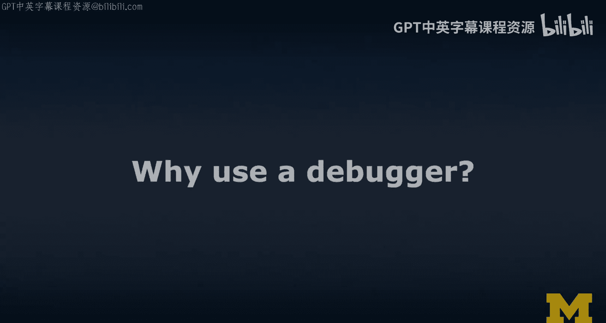
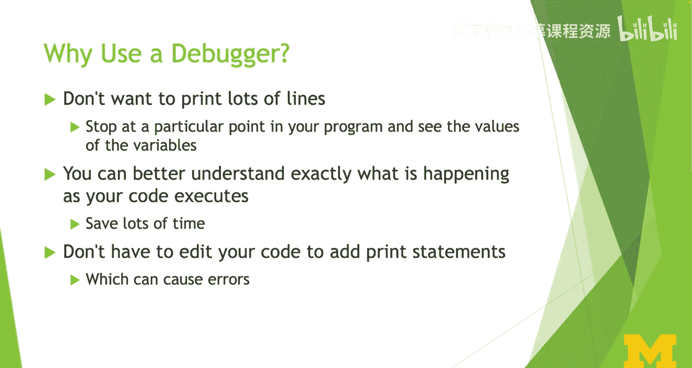

# 密歇根大学《创造性编程（创意、面向对象、debug、QA）｜Creative Coding： Hands-On Python》中英字幕 p111 23_调试器使用优势.zh_en -BV1ef421S7Bc_p111-

So why should you use it tobuggger rather than just print statements。

 So if you put print statement in and you're looping a lot of times like say you're reading lines from a file and it's a very long file。

You don't really want to look at all that print statements， that's a lot。

 so it's valuable with a debugger， you can stop at a particular point in your program and just see the values at that point so you don't have to sit there and print every single value all the time。

Thebus also help you better understand you can step through the code and see exactly what happens as every line executes。

 what's the change in the variables， where does it go next when it calls a function。

 you see it move to the function。So you really get better understanding what exactly is happening when your code executes。

 which can save you lots of time if you understand what's happening。

You don't have to edit your code and then add print statements。

 which can cause you to have errors because you accidentally destroy something that you don't want to or you forget and leap print statements in when you release your code and you don't want print statements in so rather than change your code a debuggger lets you just stop where you want't not change the code。

 see exactly what's happening， step through to see exactly what's happening。

 so I recommend you use it abuger。

