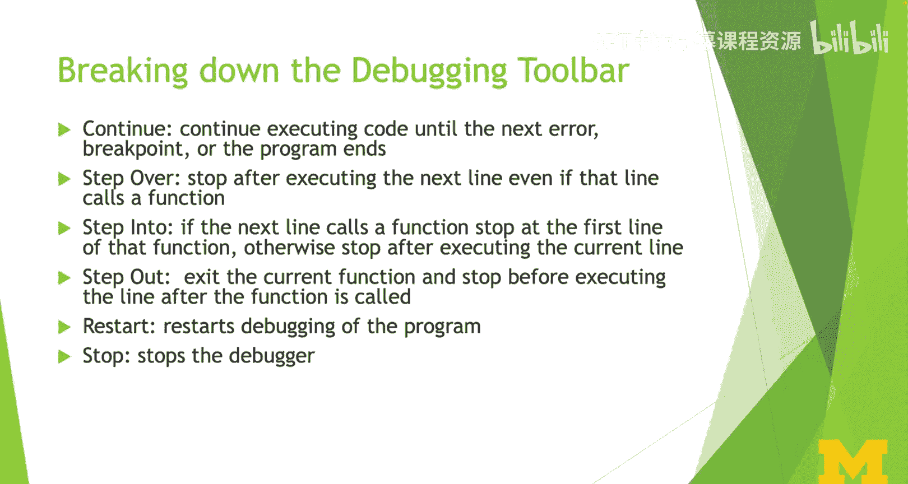
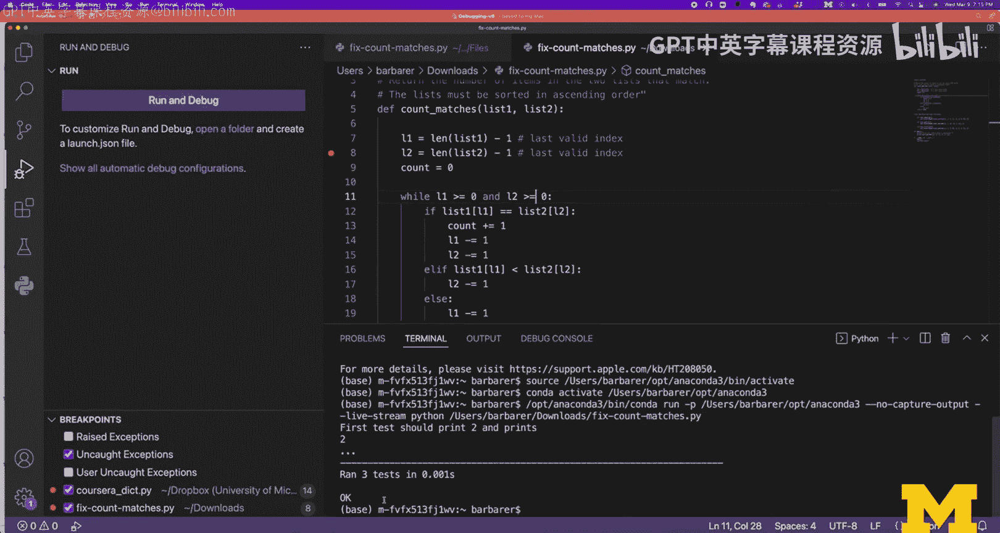

# 密歇根大学《创造性编程（创意、面向对象、debug、QA）｜Creative Coding： Hands-On Python》中英字幕 p112 24_VS Code调试实践.zh_en -BV1ef421S7Bc_p112-

So how do we use the VS code to bugger。 So the first step we want to do is set one or more break points。

 and we set a break point by clicking to the left of the line number in Vs code。

 So here you can see there's a break point set at line 8。

 There's a little red dot shown to the left of it， and I can click it again if I want to clear that break point。

 I can set multiple break points。 I can stop at multiple places。

So that's the first thing we want to do set a breakpoint， then we want to start the debugger。

 so this little bug icon we click on that and then we'll see this run and debug button and we click that。

The code will start to execute。 And then it'll stop when we get to that first break point。

 So here we see this yellow symbol around the red dot to show that we are stopped at this break point。

 We have not executed this line yet。 So we stopped。 We've executed the line above line 7。

 but not line 8。 And if you look at the variables which are on the left side。

 We see that we have L 1 defined as 2。 L 1 is defined as 1，3，7。 L 2 is 1，5，7。

 So these are both lists。 and L 1 is set to the length of list 1，-1。 So there's three items，3-1 is 2。

 So that looks correct。And so now we have to choose what to do next once we've stopped at a break point and we have many options and they're shown in these icons。

 what do these icons mean？So the first one means continue and that means go ahead and execute either until I hit another breakpoint or an error or the program stops running。

 so three possibilities。Step over is what I typically will use。

 It means if the line that I'm about to execute has a function， go ahead and just execute it。

 don't stop in the function and then stop before the next line。 Step into is sort of the opposite。

 It says if the line I'm about to execute has a function call， stop in the function。

 So step into the function and stop step out。 if I've stepped into a function。

 and I want to come back out。 I can do that。 Re will let me restart the debugging at the beginning and stop。

 We' stop the debugging。Just again to go through those。

 continue means continue executing until the next error， breakpoint or the program ends。 step over。

 stop after exiting the next line， even if that line calls a function。

 step into if the next line calls a function， then go into the function and stop。

 step out means exit the current function。 restart means restart debugging of the program and stop stops the debugger。

 So now I'm going to show you this as show you an example in visual Studio code。

 So here's some code that we want to debug。 And the first thing we'll try to do is just run it because it has some unit test。

 So let's see what happens。

So we're running the code using Ananaconda。And we see we get an assertion error that none does not equal zero。

 and we see that that happened on line 25。And so here's line 25 that called count matches and count matches。

 And it's calling it with 1，2，5，7 as the first list and 3，4，6，8。

 And it's suspecting that we're going to return 0 because there's no matches there。

 But it says that we return to none and none does not equal 0。

 When you see none return and you're expecting a number usually means you forgot to return something。

 So count matches。 We have a count that we're keeping track of how many matches where there。

 and we never return the count。 So we can fix that by just adding that count。

Return count after we finish our while loop。So I'm going to try to run that again。After we fix that。

And now we see that it no longer says none， but it still says assertion error1 does not equal to。

And it says this is the test case where we're seeing that， so we have 1，2，5，8 and 1247。

 there should be two matches， there should be one and two should match。

 but it says we got one instead of two。 so what's happening。

This is a great place to use a debugger to sort of stop and see what's happening。

 so let's try to run and debug now。So you can get rid of that。Run into bug。

And we'll stop at this break point just so we can step by step see what's happening。

So it's starting to run it。Can take a little bit time。

And I see that we've stopped at the break point， so just before we execute line 8。

 I see L1 is defined list1 list2。If these were larger。

 I could open this to see a little bit more detail， but I don't need to hear it's pretty small。

So let's go ahead and step over because we're not this isn't calling a function that we want to investigate。

 we just want to execute that line。 so if we just want to execute the next line and stop before the next line。

 that's a step over。 So we'll do that。 We'll see L2 is defined now。We'll step over this next line。

 count is0 now。 and these these variables are shown in alphabetical order。 Now we have a while loop。

 So while L1 is greater than0 and L2 is greater than 0。 So L1 is the length of the it's the index。

 the last valid index in the list and L2 is last valid index in list 2。

 So while L1 is greater than 0， which is 2。 So that's fine。 And L2 is greater than 0。

 they're both greater than 0。 So we should go into the loop， if we step over。

 if list of L1 is equal to the list at L2。 So if the values are the same， which they both are。

 they're both sevens。Then we should execute this count equals count plus one。

 and I'm just using step over here。Because we're not calling a function， so it's fine。

So we've incremented the count and we've decremented L1 and both N L2。

 so now we're going to check the things at index1。So again， they're both greater than zero。

 So we check， are they the same value， No， there's one is3 and one is5。

 so the no it should get out of the else and it does e。

Now is list is the value in list one less than the value in list two at this index， it is。

 so this should execute。And it is， so now we decrement L2。

So L2 now goes down to zero so that we can compare the one and the three to see if those are matching。

So when we step over here， we notice， oh， we've gone all the way down to return count。

 but we haven't finished looking at these onesh， so we have an off by one air。

 which is fairly common。So we could fix that。By saying while L1 is greater than or equal to0 and L2 is greater than or equal to0。

 And if I try that now， if I save that。And run it。I see that all the tests pass。

 so I've run three tests and they're all okay， so that's an example of using the debugger。

