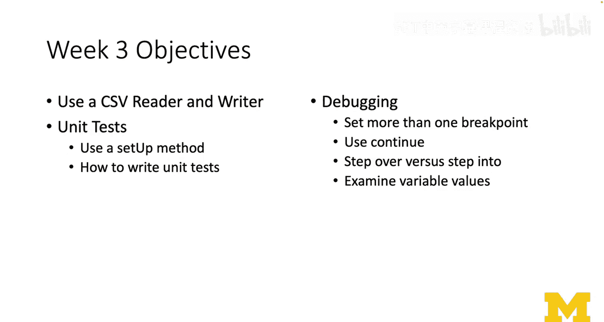
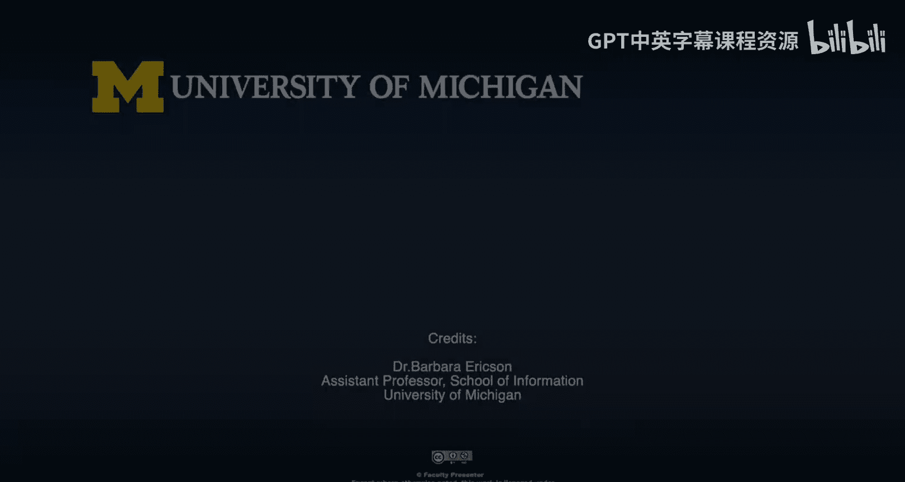

# 密歇根大学《创造性编程（创意、面向对象、debug、QA）｜Creative Coding： Hands-On Python》中英字幕 p113 25_欢迎进入第三周.zh_en -BV1ef421S7Bc_p113-

So welcome to week three This week we're going to focus on using a CSV reader and writer CSV files are so common and useful that there is a class that makes it easier to work with them。

 particularly if one of the columns contains a comma itself。

 and then you don't want to break at that comma。And then we're also going a little deeper into unit tests。

 So how do we use the setup method that gets called before every single test case that we run and to have some data all set that we can work with。

 And then with debugging， we're going to go a little deeper in the debugger 2。

 We'll set more than one break point and then use continue to go between break points。

 We'll talk a little bit more about how do when to use step over versus step into and we use。

 we'll be looking at the variable values as we're debugging。 So enjoy the week。😊。

