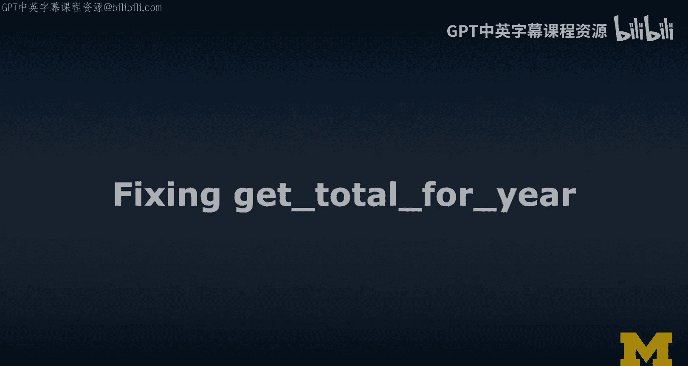
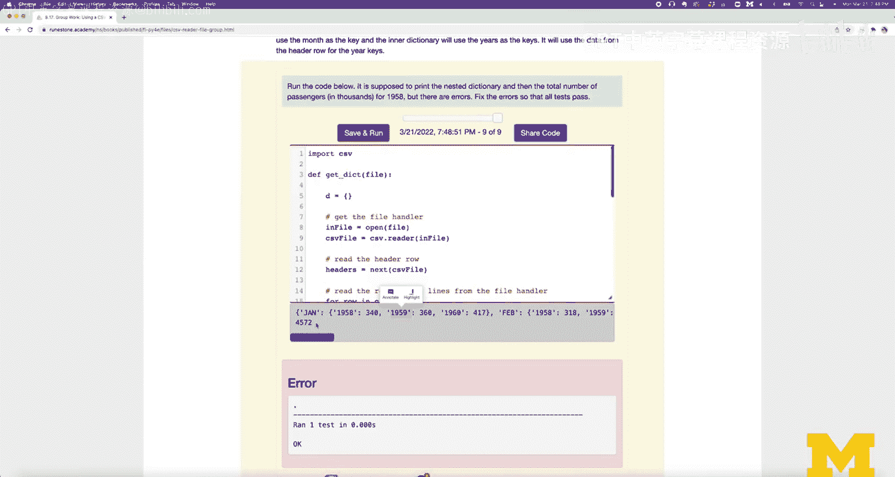

# 密歇根大学《创造性编程（创意、面向对象、debug、QA）｜Creative Coding： Hands-On Python》中英字幕 p114 26_修复年度总计函数.zh_en -BV1ef421S7Bc_p114-

So let's try to debug one of these problems。 So we're importing the CSV。

 which we have to do we using the CSV reader writer。

 We're trying to create a dictionary from the data in the file。 First， we make an empty dictionary。

 We're getting the file handler from the file。 and then we're creating the CSV reader from that。

 So if I try to run this code。 Let's see if there's any errors。

 And the first error we see is on line 9， it says there's no attribute capital art reader。

 And that's because the reader should be a lowercase letter。

So let's see what else we have as a problem。 So now it says， okay。

 we're running one of our test cases and we have a test case that's hidden。 You don't see it here。

 line 53， And it's saying get total for year given the dictionary for 1958 should be getting you4，5。

7，2， but what we got back was0。 So something's wrong there。 But if we look here。

 we see that we have an empty dictionary。 So definitely something is definitely wrong。

 we shouldn't have an empty dictionary because here's our data right here。

 So we should have this dictionary。So let's go look at that， what's happening there。

So we get the header rows。 The very first row tells you that there's month and then the years。

As a string， and then we looping through the contents of the file。 Oh， instead of in file。

 it should be a CSV file here。So we have CSV files， CSV reader。 So get the next row from that。

 and then we're looping through those rows。 Let's see if that solves some of the problem。

 So that now gives us a dictionary printing。 So at the end of this were're printing that dictionary。

 and this is what we're seeing。 But notice this。 This is going to cause us a problem， right。

 So we're looking for just this string 1958。 And what happened is it read it with the quotes around it and kept those quotes and also some blank space。

 So we don't want that to look like that。 So headers and what we have here。We need to strip that。

 We need to strip off the extra space， and。The quotes。

I'm just looking to see if there's any other weird things going on there。

 the numbers are numbers because we've converted them to numbers here， the integers， so they're okay。

So we need to strip these headers。And we want to get rid of empty space and double quotes。

So we're going to do that。There's errors compiling。Oh，St up a little bit。

 forgot to put the right print in。All right， so now we have stripped those。

 so they just look like regular strings， so that should be helpful。And the test cases now pass。

 so that's how you can debug that first one。

