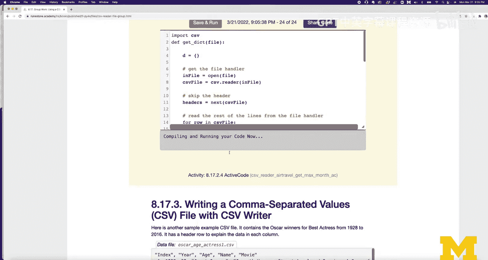
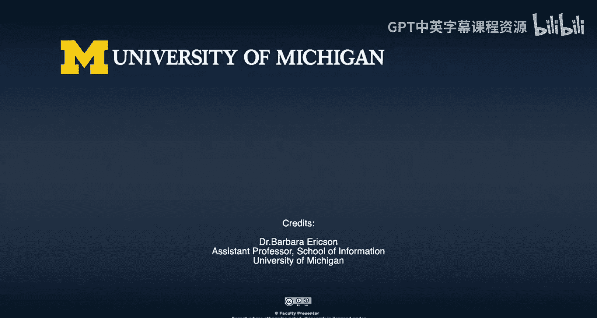

# 密歇根大学《创造性编程（创意、面向对象、debug、QA）｜Creative Coding： Hands-On Python》中英字幕 p115 27_修正最大月份错误.zh_en -BV1ef421S7Bc_p115-

So let's try to fix this one， which is the function git max month。 So if we try to run this。

 let's see what's wrong。As we get this error， CSB is not defined。And so if you look at the very top。

 that's because we didn't import CSV， so we needed to import CSV。And that gets rid of that error。

And then it says， okay， line。File and get dictionary， CSV reader。

 CSV file equals CSV reader expect at least one argument got zero。

 so there should been something passed in when we create a CSV reader repas in the thing that we already opened so that would be in file。

And look， oh， there's an error here as well。 skipping the header should be reading it from。CSB file。

 So when we see this one at length of values equal equal 4。 so something was wrong there。But， we can。

Because there's no values known here， it would be length of the row。And month would be from the row。

 not of values。 So we fixed those。And then we see header is not defined。

 well it's because it's headers here， not header， so we can fix that。Headters。

But here we see that the headers are odd because we've read the headers from the wrong。

 They've read it from in fileile as a string。 We really want it from CSV file。So if we do that。

 then we see。呃。HBut the month shouldn't， this shouldn't be a month。 This should be a year。

 So something's wrong there。 The headers shouldn't have been 0。 It should have been one。

To make sure we have the right one。 And then we have to strip off the extra space and the。

Double quotes yet。 so when we create our headers here， we want to strip。Extra space。 double quotes。

We can do that for each of the headers。All right， so that looks correct there。

 but we have September does not equal August， so something's wrong yet in our calculation。

So we could check this looks correct as far as what we have。 We have January 1958。

 we have 340 and 1959， 1960， that looks okay， February， those things look okay。

 So what's going on when we get our max month。So we started off a dictionary is empty for month in this dictionary month D equals tri dictionary in the month。

 month D equals that。 And then we sort off but lambda of T of 0 would be the。Wrong thing。

 we wanted to do it by the values。 so if we do that。

Then it passes all the unit tests。 So that's one way you can fix that。

