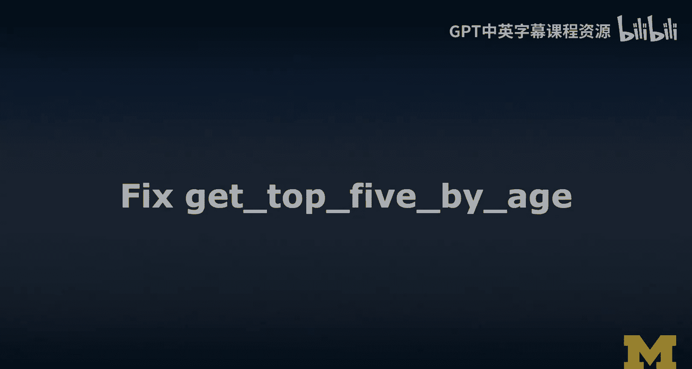
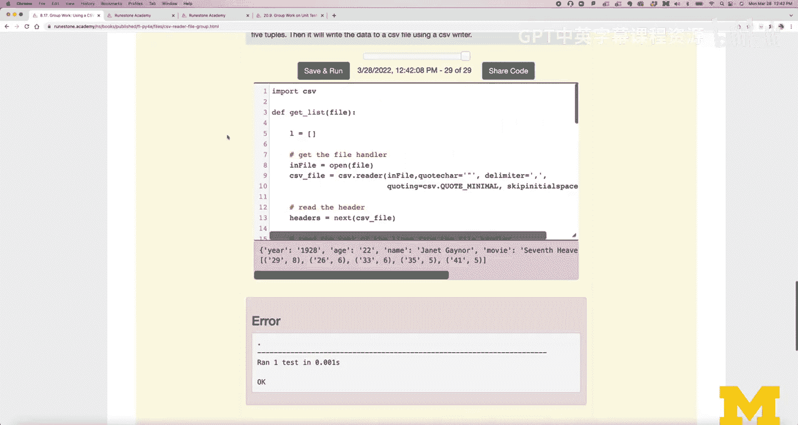

# 密歇根大学《创造性编程（创意、面向对象、debug、QA）｜Creative Coding： Hands-On Python》中英字幕 p116 28_修复年龄前五错误.zh_en -BV1ef421S7Bc_p116-

So let's try to fix another problem， so this one is supposed to try to return a dictionary that has the age and the number of actresses that want at that age。

And so it's going to loop through this file that reads information about the actresses。

 So here's the file。 So we see that it has a header row， index year age and Whitname movie。

 and then we see the data and notice like the movie title can have a comment。

 And that's part of why we need a CSV reader here。All right， so we try to run the code。

And we get an error that CSF file is not defined on line 13， so line 13。

 and we look above and it's different。 CSV underscore file， so we fixed that。If you run it again。

You still see another CSF files 16， another misspelling of it here or change in the spelling of it。

Now we have values as not defined on line 20， so for row， if length of values。

 it should be length of the rows， a row。Equals 5。And then we're getting no attribute right on a CSB writer。

 so when we try to write out information on line 46， it's not right， it's right row。

And now it's working， so that's how you can debug that one。

