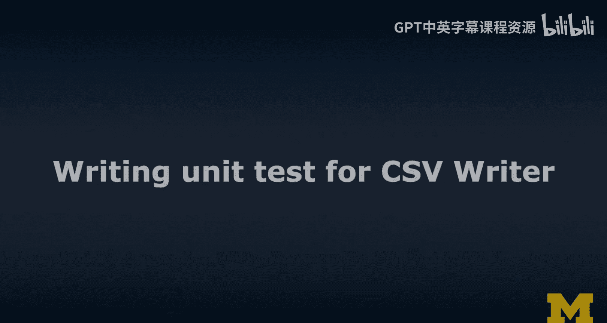
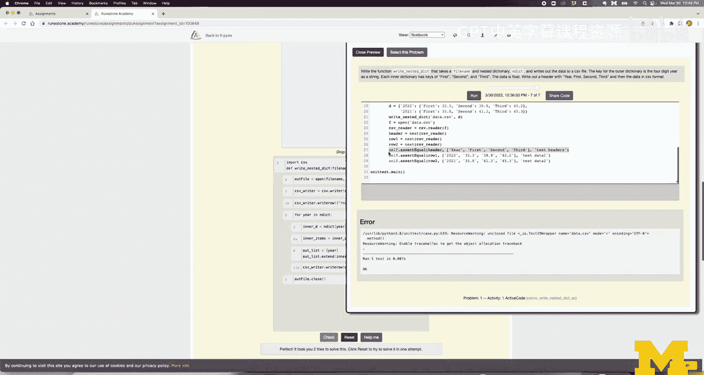
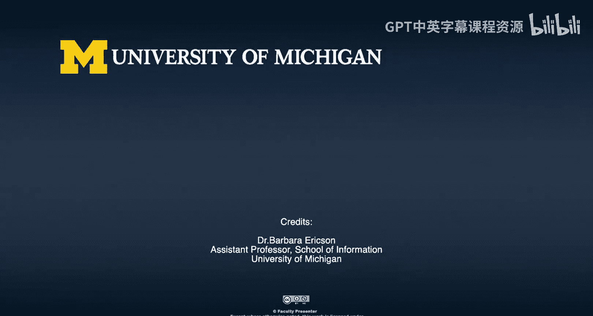

# 密歇根大学《创造性编程（创意、面向对象、debug、QA）｜Creative Coding： Hands-On Python》中英字幕 p117 29_CSV写入单元测试.zh_en -BV1ef421S7Bc_p117-

So we've been testing when we have a function that returns a value and we can use like assert equal to check that the value is what we expected from the function。

 But what do we do if a function doesn't return anything So typically a function that doesn't do doesn't return something has some sort of effect so it does something so we can test that that effect happen。

 So in this case， we're going to see that we're testing if we write a CSV file the way that we can test it is to read in the CSV file。

So here we have a function that's supposed to write a nested dictionary。

 takes a file name and a nested dictionary， and then writes that data to a file。 So the test。

 of course， we have to import unit test， we create a class， whatever whatever name we want。

 and then it inherits from unit test test case here。We create tests starting with the word test。

 So defaf test 1 that takes self the current object。

 Here we create a dictionary to pass into the function。

we call the function to go ahead and write the CSV file。

 we don't set it equal to anything because it doesn't return anything。

 Then we open that written CSV file with a file handler。 We convert that to a CSV reader。

 We read the header into a list and then we read each row， row 1 row2。

 and then we can use assert equal to check that the header equals the list we expect that the rows equal the list that we expect。

So that's how you can handle writing a test case for something that writes to a CSV file。

