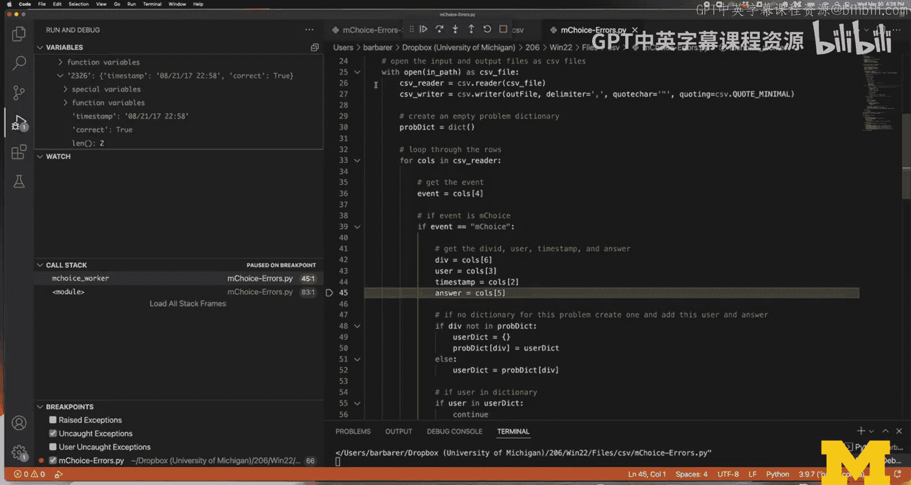

# 密歇根大学《创造性编程（创意、面向对象、debug、QA）｜Creative Coding： Hands-On Python》中英字幕 p118 30_VS Code调试器深度探索.zh_en -BV1ef421S7Bc_p118-

So let's go through a little more in depth of debugging using visual studio code。 So in this case。

 we're going to debug something that's processing log file data from the ebook。

 So in the ebook you've answered multiple choice questions。

 So this is how the log gets shown for multiple choice questions。

 There's a couple numbers you could ignore at the beginning。 Then there's a date time。

 Then there's a user I， which is a number in this case。

 then there's M choiceice to indicates multiple choice questions and then there's information about that particular thing。

 So for multiple choice questions。 What answer did they give and whether that was correct or not。

 Then there's the unique problem I for that。 So here's Q2 underscore 2 Q underscore 1。

And then there can be some other things。 But those are the things we mostly worry about or interested in。

 One of the things we've done is take just a small snippet of the log file so that we could write test cases so we could look at this。

 analyze it， figure out what the answer should be。 and then we could write test cases。

 So here we have some code， that's going to figure out how many different unique questions were there。

 how many people attempted them， how many people got them correct eventually。

 And we've already written test cases based on that small snippet。

 So if we go ahead and run this code。We see we have some errors。 for example。

 one of the things we see is an assertion error that one does not equal3 for the number of unique problems。

 So there should have been three unique problems。 So we need to investigate that a little bit more。

 This is a great place to use the debugger to see what's happening。

So we read in the data here and we grab it， we get the event， we grab all this information。

 so I'm going to put a break point right here after we've gotten all of that information up until the answer to see what's happening。

And then later on， we're going to calculate how many people got the things correct and stuff。

 So I might stop in here to see what's happening。 I'll put another break point here。

 You could have more than one break point。 You just clicked to the left of the line number。

 and you could click again if you wanted to get rid of it。 But I want to keep it。

 So let's try to debug。 So we go up to the debugger here， run and debug。And we tell it we want to do。

Oh， it's already stopped here。 Okay， so we can take a look at here's the actual data that we've gotten。

 So the 6，1，8， these numbers， the timestamp， the user I， the event。The act information， the div。

 So each of these pieces of information is here。 And now we can see what we've set so far。

 So the div says it's 12， which is not what it should be。

 The div is that unique I D for each problem。 It should be this。 Oh， what I see 12 is after it。

 So it looks like。 What would I should have done。 is0，1，2 should have been the times stampamp。

 which it is 3 should have been。The user I D， which it is 4， should have been。

 What kind of event is it。 That's correct，5 should be the answer was we said 6。

 So we're off by one here。And the divID should be number six。

 so that's one thing we need to fix already。So we could now redo this now that we've saved。

 we should save that and rerun it and see if it's not correct。

And we do see now that we have a correct timestamp。And the div is correct now。

 so now we could sort of continue。And so these are the different options we have。

 We could say continue， we should go to our next breakpoint or error or end the program。

 or we can step over， which says execute this next line and then stop after it。

 even if it's a function called don't don't go into the function。

 Step into says go into the function。 So right now， this isn't a function column。

 I'm just going to step over it。 So we see now that answer is set。 answer 3 is correct。

 that's the piece。 And we're checking to see is the div not in the problem dictionary。

 Pro dictionary is empty right now， So it's not going to be there。 And again。

 I can just step over that。 Use dictionary starts off being empty。 which I see here。

Problem dictionary of div now is user dictionary， so now we're setting that。

And if user is in the user dictionary。Which the user dictionary is empty。 So it's not going to be。

 So we'll go down to the Ls。 So we see that。 And now this is a good case of using step into。

 step into says， I want to go see what's happening in that function。 So that's this one。

 And you can always hover over them if you're not sure。 So let's step into。

 And so it stops right after it begins the function。 So I'm in to add answer。 The answer is this。

 There's the timestamp。 There's the user Id。 First， it creates an empty answer dictionary。

 It sets user dictionary for the user as the key to be that empty dictionary。 Then it says， okay。

 answer dictionary for timestamp will be the timestamp。

 answer dictionary for correct will be get corrective answer。I stepped over。

 I could have stepped into to see what was happening there。

So I could have again stepped into because correct is another call， so I could have checked that。

But I could also just look here at my problem dictionary to see exactly what I have。

So I could see that correct is true。 So that seems to be working。 So when you're debugging。

 it's very handy to set multiple break points。 At this point， I could say， well。

 that all seems to be okay。 so I could just continue， which would stop when I get to my next。

Now this is in a loop， so I'm actually going to get rid of that and I'm going to continue and now I'll stop when I get here。

So that's very handy because I don't want to step stop every time through the loop so I can set a break point。

 I can stop once and check everything out， and then I could get rid of the break point。

 and I continue until the next piece。 So that's a little bit more about how to use the debugger。

