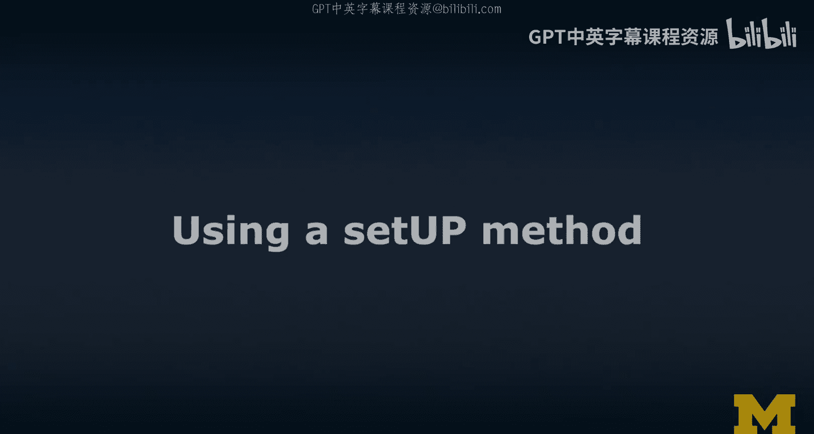
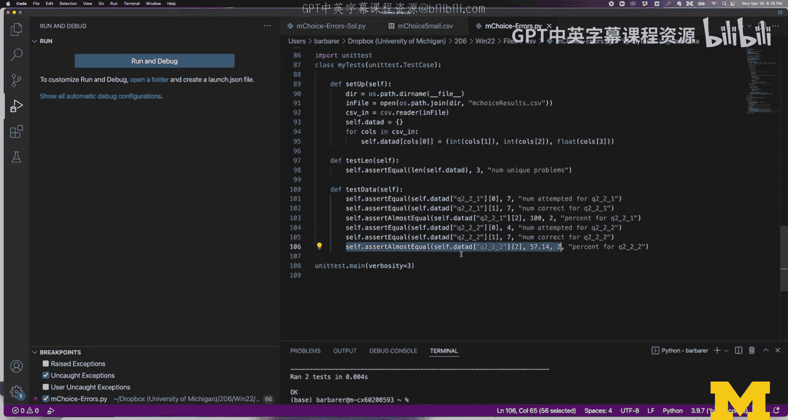

# 密歇根大学《创造性编程（创意、面向对象、debug、QA）｜Creative Coding： Hands-On Python》中英字幕 p119 31_setup方法应用.zh_en -BV1ef421S7Bc_p119-

So we're going to look at how you create unit tests when you're working with CSV files。

So here's our this is the code where we're trying to process this log file data with multiple choice questions and their answers。

 we're trying to figure out how many different unique multiple choice questions were listed here。

 how many people attempted each question， how many eventually got it correct and so you had to fix this code But when you fix the code is going to run these unit tests So let's take a closer look at these unit tests and the important thing I want you to look at here especially is this setup method So optionally in your test cases you can have a setup and that setup method is called before each and every test case so it will be called before we run test length that we get called before we run test data。

So both times it'll get called。 And what we're doing there is this code writes out to a CSV file。

 the data。 And so in the setup method， we're reading the data and storing it in a dictionary。

 So here self dot data D。 So when you're working in a unit test It's in a class。

 and there's an object of the current class notice self and saying self do data D says okay。

 add that attribute to that object And then later in each of these test cases。

 we can just use that name again， self do data D and that's what's known then and we can then compare those things so we can check the length of that。

 make sure it's3 we can check。It is a dictionary so we can get the key for one of the problem IDs and that returns a tuple and we can get these zeroth element of that tuple and check that that seven other thing to note is of course。

 if we're comparing integer values we can use assert equal， but if we're comparing floating point。

 potentially floating point values we should use assert almost equal and that's where we say what are we two things we're comparing but also to how many decimal places so that's a little bit about how you can test with CSB files when you're working with CSB readers and writers。

