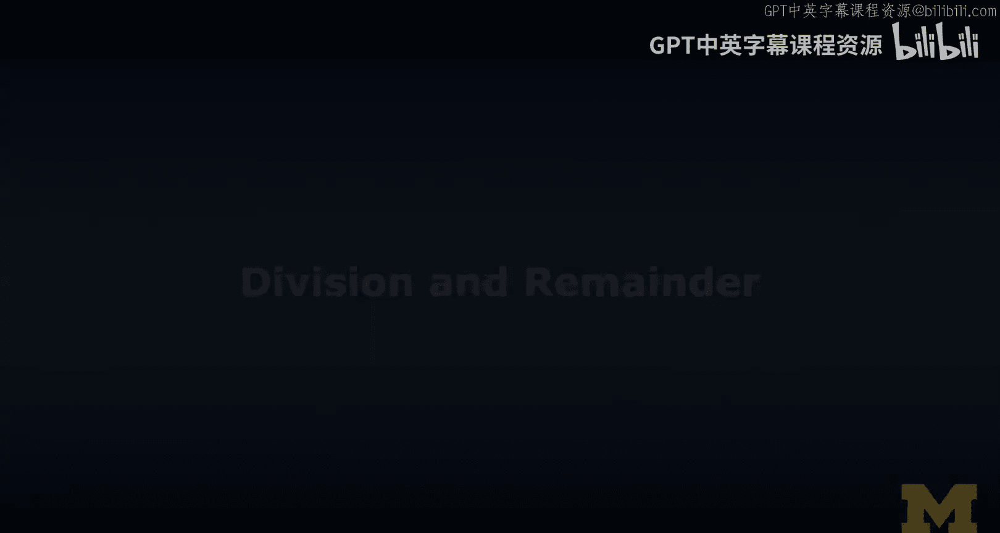
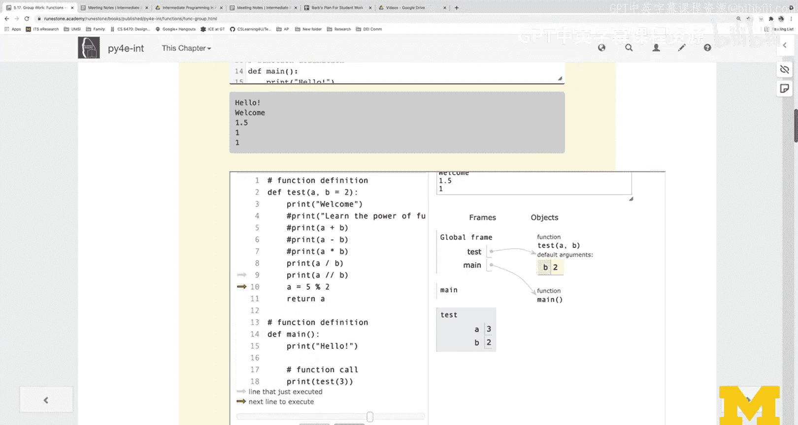
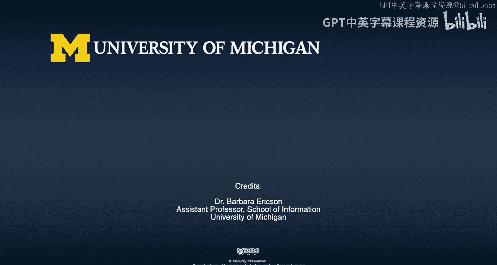

# 密歇根大学《创造性编程（创意、面向对象、debug、QA）｜Creative Coding： Hands-On Python》中英字幕 p12 11_整除-浮除与取模运算.zh_en -BV1ef421S7Bc_p12-

There's a couple of things I want to point out to you about Python， some of the basics and Python。

 and one of is the difference between inter division and floating point division。

 so let's take a look at this example。 So here I've commented out some of the additional print statements to make this easier。

 but let's look at it in the code lens to walk through exactly what's happening。

So we're going to define our function。Then we'll define our main。 We'll call the main function。

 which well go back to line 14， and we'll execute。 We'll print hello。 So we see the low print。

 Then it'll print the result of calling test with the value 3。 So now we're up at line 2。

 and we see that A is 3 and B is 2， because of the default value。 It's going to print the welcome。

 We see that。 And then it's going to go down here and print a with a single slash B。

 which is a division。 But what we get is a floating point division。

 So just the single slash in Python means a floating point division。 What about this。

 The double slash in Python means an integer division。

 So it's going to throw away any fractional part。 And what about this symbol。

 This is looks like a percent， but it's not actually in Python。

 What it does is give you the remainder when5 is divided by 2。 So2 goes into5， evenly， right。

 two times 2 is 4， but there's a remainder of 1。 This is very handy in programming when you want to do one thing。

 for example， when something's even versus one thing when something's odd。

So remember those three things， single division is a floating point division， double division。

 double slashes is a integer division， and the percent sign is actually a modulus or remainder operator。

