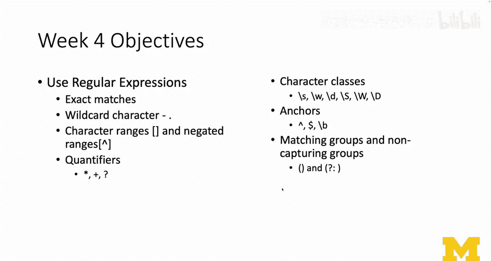
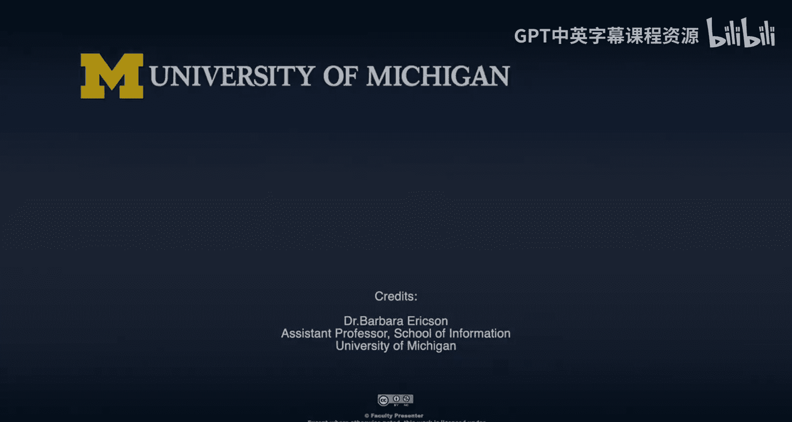

# 密歇根大学《创造性编程（创意、面向对象、debug、QA）｜Creative Coding： Hands-On Python》中英字幕 p120 32_欢迎进入第四周.zh_en -BV1ef421S7Bc_p120-

Welcome to week 4。 This week， we're going to learn how to use regular expressions to make it easy to search for things or to validate text。

 So what's regular expressions。 Reg expressions are a sequence of characters that very concisely specify how to match text。

 And they used to both validate things like passwords or entry like in the ebook。

 we actually use them when you do fill in the blank problems。 They're also used to find text。

 So for looking through files for particular things。

 It makes it easier for us to specify what kind of pattern do we want to match in order to find text。

😊，So what we're going to cover is using exact matches plus the wild card character。

 So period matches anything other than new line Tercut arranges So like from lowercase A to lowercase Z。

 and negated ranges， anything except that quantifier。 So how many to match0 to many。

1 to many optional，0 to1 character classes。 So there's ways of specifying。

 I want space sort of things or nonspace or alphamer plus underscore or And then there's also anchors to say。

 oh， I'd have to start a string or it has to start a word boundary。

And then you have to be careful with parentheses because that actually indicates a matching group。

 and so there's a way to also negate that by non capturing groups， so enjoy the week。

