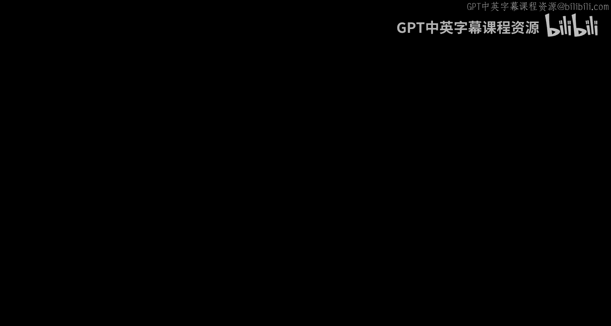
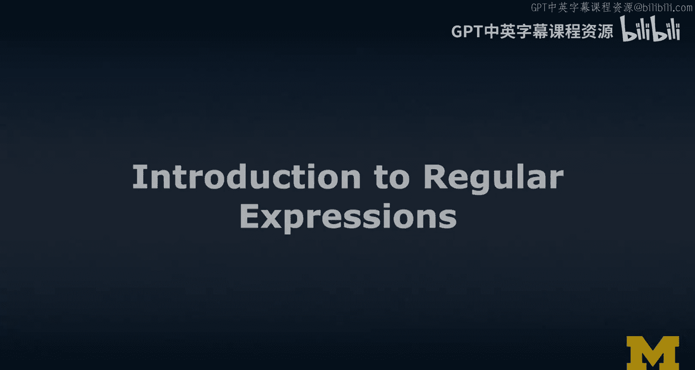
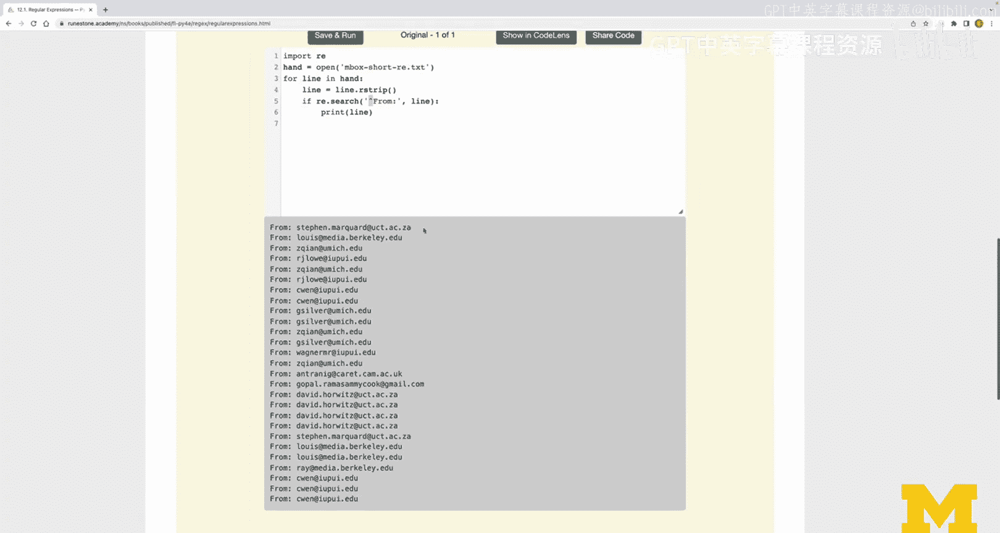
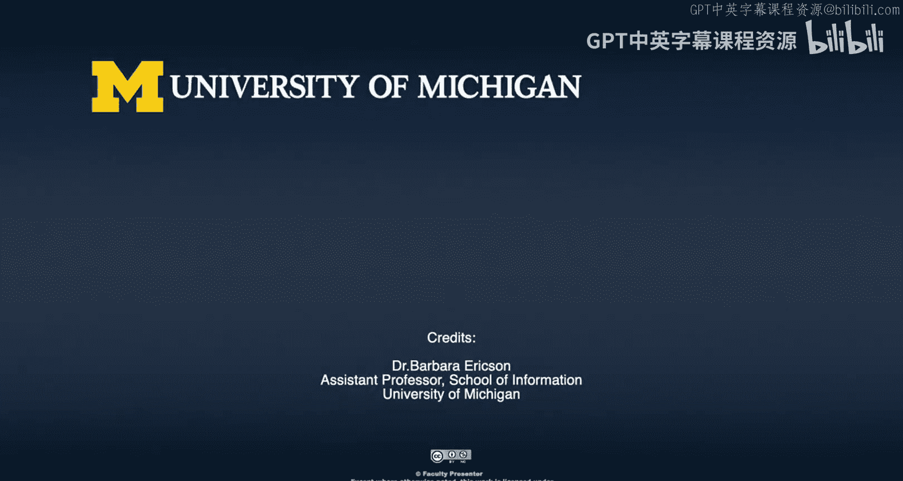

# 密歇根大学《创造性编程（创意、面向对象、debug、QA）｜Creative Coding： Hands-On Python》中英字幕 p121 33_正则表达式入门.zh_en -BV1ef421S7Bc_p121-

So let's look a little bit deeper at regular expressions and how we use them。

 Here's a very simple example that's just looking for these particular characters。 So from Col。

 and it's looking to see， hey， are these in this line， what I'm reading from the file。

 And if they're there， print the line。 So let's run that。

And we'll see we get from Col and then an email address。Which we could then pull out from that。

 we could use string to split that on the colon， we could strip the extra space around and we could get the email address。

But there's easier ways to do that。 But this also doesn't make sure that we're only getting it at the beginning of a line。

 And this doesn't really show the power of regular expressions because we could just use a string fine as well to do this。

 So one of the things you can do is specify with the carrot that only look for this at the beginning of the string。

 So if we do that， do we get anything different。Maybe a few of these are different。

 but we would still could use string split or。To find just the piece of the email。

 but we can also use regular expressions to narrow down that so that's some of what you're going to learn this week is how do I write these regular expressions to find just the pieces I want。

