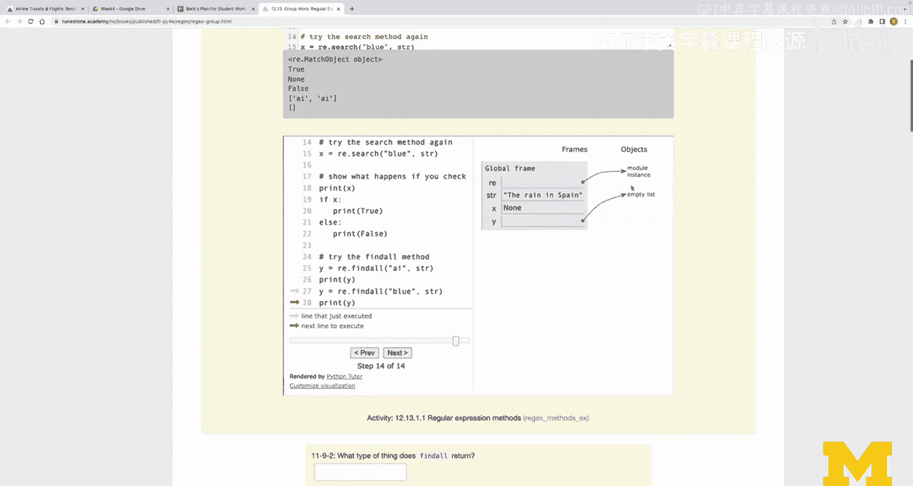

# 密歇根大学《创造性编程（创意、面向对象、debug、QA）｜Creative Coding： Hands-On Python》中英字幕 p122 34_search与find_all区别.zh_en -BV1ef421S7Bc_p122-

So let's look at the difference between search and find all a little bit more closely。

 We can show it in the code lines that way we can walk through and see what's happening。

 It's a little bit long， so we'll have to scroll down a bit to get to the next button。

 So the first thing we're going to do is import re。

 which is importing the regular expression library。

 We have to do that when we're using things outside the core Python language。

 Then we're going to create our string。So here we see the string。

 Now we're going to try using search our E dot search for AI in string。 When we do that。

 we see we get a match object that says I found a match at from starting at index 5。

 ending exclusive at index 7， the matches AI。And then if I can use that to say， hey。

 if did that search work or not， so I can say if X， then print true。

 which in this case it will print true。And then I can now try what happens if I don't find it。

 So I'm going to search for blue。 That's not in the string。 If I do that。 I see X is none。

 And then I can check that If X print true， otherwise print false， and it would print false。

 And now let's try the find do。 So find all of AI and string。

 and notice there's two that it returns because it finds this one。 and then this one。

And so this returns a list of all the matches。 And then I can print that。

 And I can now try find all of blue。 And what I get then is the empty list。

 So the big difference is search looks for the first match and returns a match object that describes that first match or none。

 if none is found， whereas find all will return all the things that match or an empty list if there's none found。

