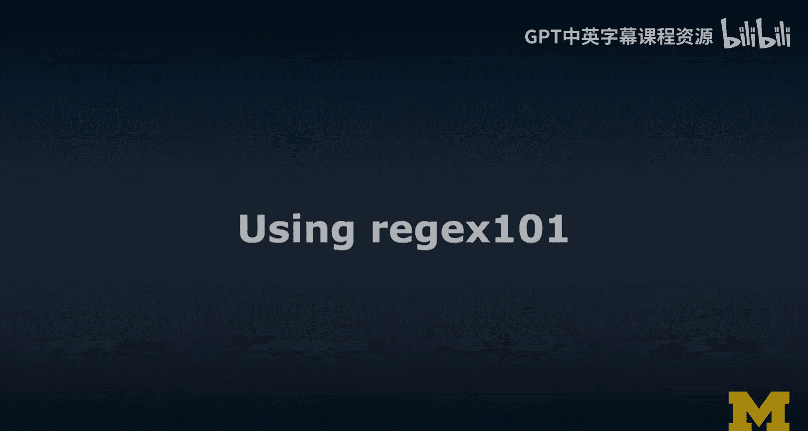
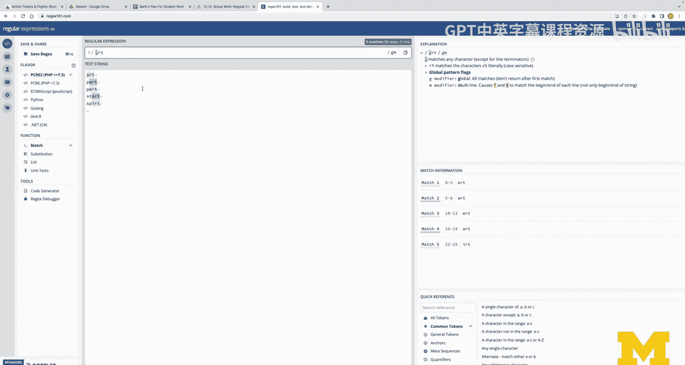
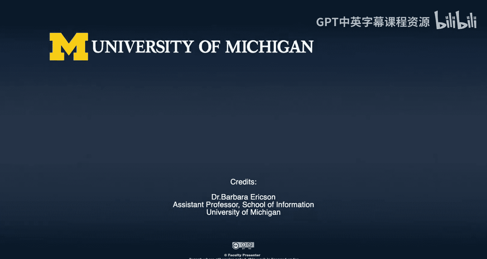

# 密歇根大学《创造性编程（创意、面向对象、debug、QA）｜Creative Coding： Hands-On Python》中英字幕 p123 35_regex101工具使用.zh_en -BV1ef421S7Bc_p123-

One of the nice things about regular expressions is you can use some online tools to help you evaluate them before you write them in your Python code。

 For example， here's rex 101 co。 And you can just type in your regular expression here and some test strings。

 And you can see what's matching。 so I can see if I type in just art， No special characters。

 So it's just going to directly match those characters， A followed by R followed by T。

 I say I can recognize art， the art part in part， I don't recognize per start spirit。

 So one of the easiest regular expressions is just an exact match。

 If you don't use any special characters that are special meaning in Regx。

 then you just match those particular characters。😊，I can start using regular special characters。

 So one of the big special characters is period and period means it's going to match any character except for end of line。

 So then I would get all of these will match。 So art IT， ERT。

 So it says any character except for new line followed by RT is what this is specifying。

So that's really the basics of redjas。

