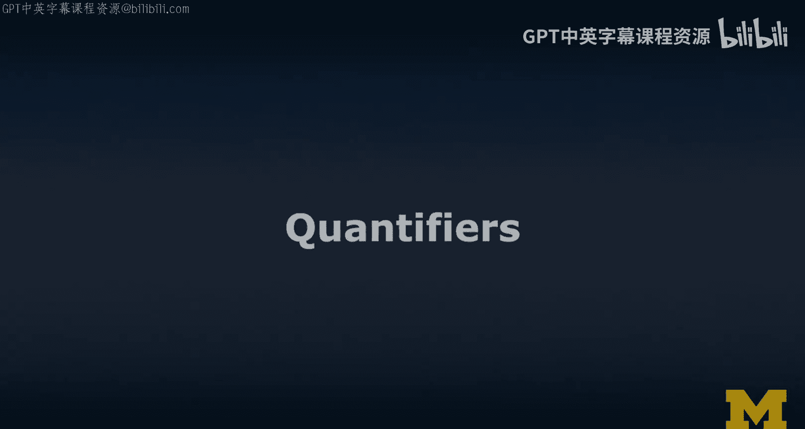
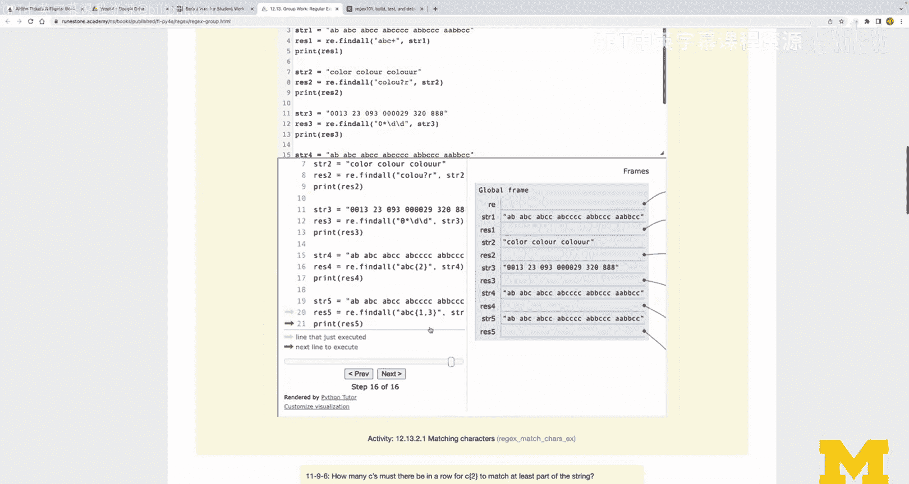
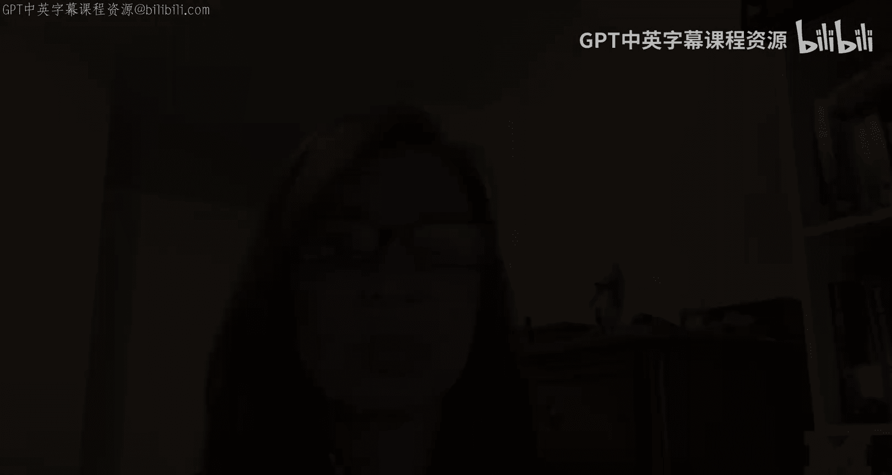
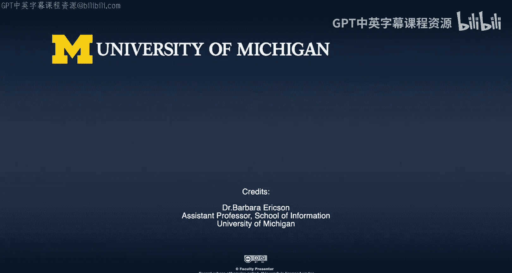

# 密歇根大学《创造性编程（创意、面向对象、debug、QA）｜Creative Coding： Hands-On Python》中英字幕 p124 36_量词应用解析.zh_en -BV1ef421S7Bc_p124-

So one of the things you can do is specify quantifier。

 So how many of the expression on the left do you need in order to match。

 So let's walk through this with the code lens to see what's happening here。

 So we have to import the R E library as usual， and we're going to declare a string to look at and then we're going to say。

 okay， find all with ABC followed by a plus。 So what does the plus do here。So Res one。

We have a match for ABC， ABCC， ABC，cc， but not for A， B。

 So this says there has to be at least one or more of these of this C character。

 So the thing did a left。 So that says a followed by B， followed by one or more C。

 So the plus means one or more。 What about this here。 So let's go down and finish that up。

So when we have the question mark， what does that do， So we can see from its matches， we have。

It matches， O， L O， R and L O， U R。And we said， you followed by a question mark。

 so it matched without the you and with the you。But not with two U。 So the question mark means0 to1。

 So sort of you can call it optional， right， I could have that。 I don't have to have the U。All right。

 let's look at the next one。So the star， what do we match here with the star and the slash D means a digit from0 to9。

 so this is saying a0。And then followed by slash D twice。 So two digits that are 0 to 9。

 So do we have a 0 with a star。 What are we matching here。And we're matching。Pretty much all of it。

 everything matches。 So it don't。 So the 0， we didn't have to have basically。

 because some of these don't have a 0 in front， followed by two digits。

 So the star means 0 to many of those。When you have curly braces with a number， what does that do。

 so let's look at this。So here we see。That we're matching。Only2。

 And so that when you put it in a curly brace and you say a number， it means match exactly that many。

 So two of those， what about this curly brace with one number，a， Another number。 What does that mean。

So if I see what I match here， I see and we're saying for the C1 to3。

 So we only match when there's between one and three inclusive。 we don't match when there's。

Less than that or greater than that， so that is an specific range from this number to this number inclusive and so those are the quantifiers。

